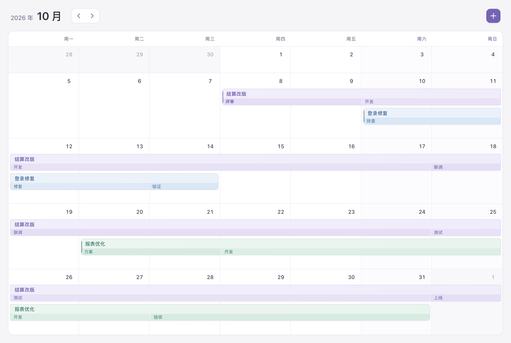
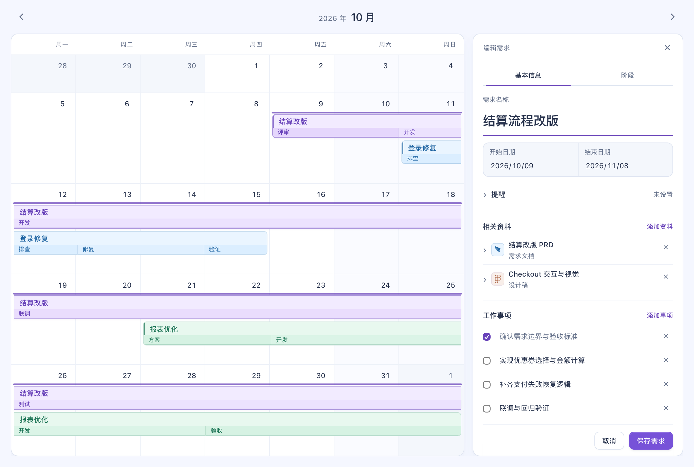

<p align="center">
  
</p>

<h1 align="center">需求日历</h1>

<p align="center">把排期、阶段和资料，放回同一条需求里。</p>

需求日历面向需要同时推进多个需求的程序员：用月历观察交付周期，用连续长条展示需求，在条内区分评审、开发、联调和测试，再把文档、设计稿、接口约定与备忘集中到需求详情中。

当前包含 macOS 桌面应用工程和可离线打开的浏览器版本。桌面版使用 AppKit 原生窗口与菜单，界面由系统 WebKit 渲染；已支持独立本机数据文件、备份恢复和按需求设置的可选系统提醒。当前没有发布经过公证的下载包。



*桌面版实际运行截图，使用内置示例需求。*

## 安装与启动

### macOS 桌面版：从源码安装

需要 macOS 15 或更新版本、Xcode Command Line Tools（提供 Swift 编译器）和 Python 3。应用启动不依赖 Python、Node.js 或常驻本地服务。

1. 下载 ZIP，或使用下方的 Git 命令克隆仓库。
2. 在终端进入解压后的项目目录。
3. 首次需要安装编译工具时运行 `xcode-select --install`，按系统提示完成安装；确认 `swiftc --version` 和 `python3 --version` 可用。
4. 执行构建并打开应用：

```bash
chmod +x scripts/build-macos.sh
scripts/build-macos.sh
open "dist/需求日历.app"
```

构建脚本会生成与当前 Mac 架构相同的 `.app`，包括多尺寸马赛克图标，并进行本机临时签名。可把 `dist/需求日历.app` 拖入“应用程序”文件夹，再从启动台或 Spotlight 打开。更新源码后重新构建，并替换旧应用。

这不是经过 Developer ID 签名与 Apple 公证的分发包；目前不提供 DMG、Homebrew 或自动更新。

### 浏览器版环境要求

- 使用近期版本的 Safari、Chrome 或 Edge。
- 下载文件后即可本地打开；核心日历功能不需要后端服务。
- 本仓库为私有仓库，下载或克隆时需要具有读取权限的 GitHub 账号。

### 方法一：下载 ZIP

1. 登录 GitHub，打开 [requirement-calendar 仓库](https://github.com/11eleve/requirement-calendar)。
2. 点击 **Code → Download ZIP**，下载并解压。
3. 在解压后的目录中找到 `index.html`，双击并选择浏览器打开。
4. 首次打开时会看到示例需求，可直接点击查看或编辑，也可创建自己的排期。

请打开根目录的 `index.html`。`src/` 保存可维护的界面和数据源码；修改后运行 `python3 scripts/build.py` 重建独立页面。

### 方法二：通过 Git 克隆

先完成本机 Git 对 GitHub 的认证，再执行：

```bash
git clone https://github.com/11eleve/requirement-calendar.git
cd requirement-calendar
open index.html
```

`open` 为 macOS 命令；其他系统可在文件管理器中打开 `index.html`。

### 可选：通过本地 HTTP 服务运行

如果希望以固定的本地地址访问，且已安装 Python 3，可在项目目录执行：

```bash
python3 -m http.server 8080 --bind 127.0.0.1
```

然后在浏览器打开 [http://127.0.0.1:8080](http://127.0.0.1:8080)。在终端按 `Ctrl+C` 停止服务。

这是本机静态文件服务，不会同步需求到 GitHub。建议始终使用同一种打开方式和同一个地址，以保持浏览器存储位置一致。

## 功能

### 月历排期

月历是主视图，顶部箭头用于切换月份，加号用于新建需求。平时保留完整日历空间，创建需求或点击已有需求后再展开详情面板。

需求由开始日期和结束日期定义，可以持续一天，也可以跨周、跨月；同一时间有多个需求时，长条分行排列。较长的交付周期和短期修复都能放在同一张日历中查看。

### 点击与拖动创建

| 操作 | 结果 |
| --- | --- |
| 点击空白日期 | 创建当天的需求，并预填起止日期 |
| 从开始日期拖动到结束日期 | 创建覆盖整个范围的需求 |
| 反向拖动或跨周拖动 | 自动整理起止日期，跨周延续范围条 |
| 点击顶部加号 | 打开新建表单，手动设置周期 |

点击和拖动使用彩色条反馈，日期格子不会整块变色。松开鼠标后，范围条会在编辑期间持续显示；修改起止日期时同步变化，取消或关闭编辑时清除，保存后由正式需求条接替。按 `Esc` 可以取消正在进行的拖动。



*实际运行截图：资料和工作事项在基本信息中，超长内容在面板内部滚动。*

### 在需求条内安排阶段

评审、开发、联调、测试和上线等阶段，直接显示在原需求长条内部。阶段名称可以自定义，无需再创建独立日历事项。

在编辑面板的 **阶段** 页中添加名称与起止日期。阶段日期需要落在需求周期内，同一需求的阶段不能互相重叠。保存前会检查这些规则，并提示需要修改的字段。

例如，一个持续数周的结算改版，可以在同一条中依次展示“评审 → 开发 → 联调 → 测试 → 上线”，点击后查看完整阶段安排。

### 按需求集中管理资料

资料放在 **基本信息** 中，每份资料都可以设置：

| 字段 | 用途 |
| --- | --- |
| 名称 | 自定义资料标题，如“结算改版 PRD”或“支付接口约定” |
| 类型 | 自定义分类，如文档、设计稿、接口、问题记录 |
| 链接 | 可选，填写 `http://` 或 `https://` 地址 |

可以添加、编辑和移除资料，没有固定的 PRD 或设计稿字段。资料行默认紧凑展示，展开后编辑具体内容；较长的资料列表在面板内滚动。

当前根据链接或类型展示钉钉、Figma、代码等简化标识，尚未获取真实的网站 favicon 或浏览器标签页图标。

### 进度与事项

需求详情展示当前阶段、阶段日期、工作事项的完成数量，以及事项与备忘。工作事项可逐项勾选，备忘可记录评审结论、阻塞原因、接口约定和验收注意点。

在 **基本信息 → 工作事项** 中添加、修改或移除事项，记录每一项的完成状态。事项必须有明确内容，保存时会一起校验。备忘保留换行，适合记录评审结论和阻塞信息。

### 紧凑编辑与外观

编辑面板分为 **基本信息** 和 **阶段** 两页，名称、周期、资料与备忘集中在基本信息中。面板高度受限，超长内容在面板内部滚动。

界面跟随浏览器的浅色或深色外观。点击与范围变化使用简短动画，并尊重系统“减少动态效果”偏好。

### 桌面操作与编辑保护

macOS 菜单栏提供文件、编辑、显示和窗口菜单，支持系统剪切、拷贝、粘贴、全选与文字撤销。点击资料链接时，桌面版交由默认浏览器打开。

| 快捷键 | 操作 |
| --- | --- |
| `⌘N` | 新建需求 |
| `⌘S` | 保存当前编辑 |
| `⌘W` | 关闭详情 |
| `⌘⌥←` / `⌘⌥→` | 切换月份 |
| `Esc` | 取消拖动或关闭详情 |
| 日期获得焦点后按方向键 | 左右移动一天，上下移动一周 |
| 页签获得焦点后按左右方向键 | 切换基本信息与阶段 |

未保存内容时，切换需求或关闭编辑器会询问保存、不保存或继续编辑。桌面版关闭窗口或退出应用时也会提供原生保存提示。保存失败会显示原因并保留表单，可以修复存储问题后重试。

详情中的 **删除需求** 会立即移除排期，左下角提供 **撤销删除**；撤销只恢复最近一次删除，退出应用后不保留撤销记录。

### 可选的系统提醒

桌面版在 **基本信息 → 提醒** 中设置本机日期与时间。默认不提醒，也不会在首次打开应用时申请通知权限。首次保存带有未来提醒时间的需求时，macOS 会询问是否允许通知。

允许后，提醒交给 macOS 的本地通知系统安排；修改时间会替换原提醒，清空时间或删除需求会取消提醒，撤销删除会恢复尚未到期的提醒。点击通知会打开对应月份与需求；如有未保存编辑，会先保护草稿。

拒绝授权不会阻止保存需求，窗口会明确显示提醒未启用。可稍后在 **系统设置 → 通知 → 需求日历** 中允许通知。系统“专注模式”和通知展示设置仍会影响横幅与声音。

提醒逻辑已通过隔离适配器测试；真实系统授权与通知投递仍需在本机进行手动验证。浏览器版不提供系统提醒时间控件。

### 备份与恢复

桌面版通过原生 **文件** 菜单提供：

- **导出备份…**：使用系统保存窗口，将全部已保存需求导出为 JSON 文件。
- **从备份恢复…**：选择 JSON，校验后展示需求数量，确认后替换当前记录；原记录会保留。
- **显示数据文件夹**：在 Finder 中定位数据与自动备份。

备份操作前需保存或取消当前编辑。恢复会替换全部需求，请先导出需要保留的当前版本。无效格式、重叠阶段、重复标识或损坏内容不会被直接写入。

## 第一次使用

1. 在月历中拖出一个需求周期。
2. 填写需求名称，确认起止日期。
3. 在基本信息中添加文档、设计稿或其他资料。
4. 切换到阶段页，填写评审、开发、测试等阶段及日期。
5. 保存后在日历中查看长条；点击需求继续跟进资料、事项和备忘。

## 数据与当前版本

| 项目 | 当前状态 |
| --- | --- |
| 运行形式 | macOS AppKit / WebKit 桌面版，以及离线 HTML 浏览器版 |
| 数据位置 | 桌面版使用 `~/Library/Application Support/RequirementCalendar/calendar.json`；浏览器版使用该浏览器的 `localStorage` |
| 需求数量 | 已移除 16 个需求的人为限制；实际受设备与存储容量影响 |
| 保存与恢复 | 原子写入；独立保留 `calendar.last-good.json`；损坏记录先保留再恢复，多个应用进程的过期更改不会覆盖较新记录 |
| 备份导入导出 | 桌面版文件菜单支持完整 JSON 备份；无云端同步 |
| macOS 应用 | 可从源码构建 `.app`；尚未提供公证安装包 |
| 系统提醒 | 桌面版可按需求设置，需用户授予通知权限；真实投递仍待手动验证 |
| 菜单栏、开机启动 | 尚未接入 |
| 系统日历同步、数据库 | 尚未接入 |

桌面版独立数据文件不随 WebKit 缓存清理而消失；首次启动会迁移旧版桌面应用的 WebKit 记录，并保留旧记录。浏览器版的数据仍可能受隐私模式或清理浏览器存储影响。自动备份与主文件位于同一目录，建议定期导出备份到其他位置。桌面版与浏览器版之间不自动同步。

## 开发与验证

```text
requirement-calendar/
├── index.html                 # 构建后的离线浏览器页面
├── src/
│   ├── index.html             # 页面结构
│   ├── styles.css             # 布局、外观与动效
│   ├── app.js                 # 日历与编辑交互
│   ├── model.js               # 数据与日期校验
│   └── storage.js             # 存储、迁移与恢复
├── native/                    # AppKit 窗口、菜单、关闭保护与链接路由
├── scripts/                   # 单文件页面与 macOS 应用构建
├── tests/                     # 模型、构建、原生策略与 WebKit 回归
├── docs/OPTIMIZATION_LOG.md    # 50 轮优化记录与验证范围
└── assets/                    # 图标、实际运行截图与功能示意源文件
```

修改 `src/` 后重建浏览器版本；修改 `native/` 后重新构建应用：

```bash
python3 scripts/build.py
scripts/build-macos.sh
```

数据与构建测试需要 Node.js 以及 Python 3：

```bash
node --test tests/model.test.cjs
python3 tests/build.test.py
```

桌面运行回归和各轮证据见 [优化记录](docs/OPTIMIZATION_LOG.md)。回归使用隔离存储，不写入正式应用记录。两张早期功能示意图仍保留 PNG / SVG 源文件，供理解排期关系与后续修改。
