<p align="center">
  
</p>

<h1 align="center">需求日历</h1>

> 本分支为 `explore/planning-workflow`，当前源码版本为 **0.4.0-alpha.4**。稳定版 0.3.0 保留在 [main](https://github.com/11eleve/requirement-calendar/tree/main)，下方稳定版安装链接继续指向 0.3.0。

前一探索版 **alpha.3** 的 Windows x64 安装包可从[本次构建产物](https://github.com/11eleve/requirement-calendar/actions/runs/37970264714/artifacts/11635107667)下载，运行 `RequirementCalendar-0.4.0-alpha.3-x64-Setup.exe`。已通过开发、打包与实际安装检查。试用前可用文件菜单导出 JSON 备份；产物于 2026-11-08 到期。

<p align="center">面向程序员的需求排期工具，把周期、阶段、资料和事项放在一起。</p>

一个需求可能持续几周，中间经历评审、开发、联调和测试；临时修复又可能只占一两天。需求日历以月历为主视图，用一条连续的长条表示完整需求，把各个阶段标在条内。点击需求，即可查看对应的文档、设计稿、工作事项和备忘。

**提供 macOS 原生桌面版、Windows Electron 桌面版，以及可离线打开的浏览器版。** 桌面版支持独立窗口、系统菜单、本机数据文件、JSON 备份恢复、Excel 导出和可选系统提醒。Windows 使用 `.exe` 安装包；macOS 目前从源码构建，尚未提供公证 DMG。下方实际截图来自 macOS，共用的日历界面和动画在 Windows 中保留。

<p align="center">
  <a href="#安装">安装</a> · <a href="#功能介绍">功能介绍</a> · <a href="#第一次使用">第一次使用</a> · <a href="#数据与备份">数据与备份</a> · <a href="#常见问题">常见问题</a>
</p>


*桌面版实际运行截图，展示示例排期。浅蓝白底色承托月历，需求以明亮的紫、蓝、薄荷绿区分，阶段保持在同一需求条内。*

## 安装

### Windows 桌面版

支持 **Windows 10 / 11 的 x64 设备**。安装后无需 Node.js、Python、本地服务器或浏览器。ARM64 和 32 位安装包暂未提供。

#### 下载并安装

当前已验证版本：**0.3.0**，可下载 [Windows x64 安装包与测试报告](https://github.com/11eleve/requirement-calendar/actions/runs/37961130646/artifacts/11631388599)（需登录有仓库权限的账号，产物于 2026-11-08 到期）。也可按以下步骤获取后续版本。

1. 登录有仓库访问权限的 GitHub 账号，打开 [Windows desktop 构建记录](https://github.com/11eleve/requirement-calendar/actions/workflows/windows-desktop.yml)。
2. 选择最新成功的构建，在 **Artifacts** 中下载 `RequirementCalendar-Windows-x64` 并解压。构建产物保留 30 天，过期后可重新运行工作流。
3. 运行 `RequirementCalendar-0.3.0-x64-Setup.exe`，选择安装目录并完成安装。安装器为当前用户安装，创建开始菜单和桌面快捷方式。
4. 从“需求日历”快捷方式打开应用。点击或拖动日期即可创建需求。

安装包目前未购买 Windows 代码签名证书，SmartScreen 可能提示发行者未知。请先核对仓库和构建来源；ZIP 内提供 `.sha256` 文件，可用 PowerShell 的 `Get-FileHash .\RequirementCalendar-0.3.0-x64-Setup.exe -Algorithm SHA256` 核对。

更新前导出备份并退出旧版，再运行新安装包。卸载默认保留本机数据；再次安装后可以继续使用原记录。Windows 和 macOS 之间可通过 **文件 → 导出备份 / 恢复 JSON 备份** 迁移，不会自动同步。

#### 从源码开发或构建

安装 Node.js **22.12 或更新版本**（推荐 24 LTS），获取源码后在 PowerShell 中进入项目目录：

```powershell
npm ci
npm run desktop
```

首次启动会下载固定版本的 Electron 运行时，需要联网。打包安装器时在 Windows 上执行：

```powershell
npm test
npm run test:desktop
npm run dist:win
```

安装包输出到 `dist/windows/`。开发模式支持本机保存和备份；**系统定时提醒需使用安装后的 Windows 版本**，以便注册开始菜单标识与通知点击协议。直接运行 `win-unpacked` 或开发窗口不等同于完成安装。

### macOS 桌面版

#### 环境要求

| 项目 | 要求 |
| --- | --- |
| 系统 | macOS 15 或更新版本 |
| 编译工具 | Xcode Command Line Tools，包含 Swift 编译器 |
| 构建工具 | Python 3；使用 Git 克隆时还需要 Git |
| 仓库权限 | 当前为私有仓库，下载和克隆需要有读取权限的 GitHub 账号 |

Python 和编译工具仅在构建时使用。生成的应用启动时不需要 Node.js、Python 或本地服务器。

#### 1. 准备编译环境

如果尚未安装 Xcode Command Line Tools，在终端执行，按系统提示完成安装：

```bash
xcode-select --install
```

然后确认以下命令可用：

```bash
swiftc --version
python3 --version
```

如果提示找不到 `python3`，需要先安装 Python 3，再继续构建。

#### 2. 获取源码

完成本机 Git 对 GitHub 的认证后执行：

```bash
git clone https://github.com/11eleve/requirement-calendar.git
cd requirement-calendar
```

也可以登录 [GitHub 仓库](https://github.com/11eleve/requirement-calendar)，选择 **Code → Download ZIP**，解压后在终端进入包含 `README.md` 和 `scripts/` 的项目目录。

#### 3. 构建并启动

在项目目录中执行：

```bash
chmod +x scripts/build-macos.sh
scripts/build-macos.sh
open "dist/需求日历.app"
```

构建脚本会生成适合当前 Mac 架构的应用，包含多尺寸应用图标，并进行本机临时签名。构建成功后，应用位于 `dist/需求日历.app`。

#### 4. 放入应用程序文件夹

在 Finder 中打开项目的 `dist` 文件夹，将 **需求日历.app** 拖入“应用程序”。以后可以从启动台或 Spotlight 打开。

全新安装会打开空白月历，直接创建自己的需求；已有记录会自动载入。README 截图使用专门的示例数据。

更新时先退出应用，获取新源码，重新运行构建脚本，再替换旧应用。本机数据保存在应用包之外，替换 `.app` 不会主动删除已有需求；更新前仍建议导出备份。

> 当前使用本机临时签名，尚未提供 Developer ID 签名与 Apple 公证的分发包，也没有 Homebrew 安装或自动更新。

### 浏览器版：免构建体验

下载并解压仓库后，用 Safari、Chrome 或 Edge 打开**根目录的 `index.html`**，即可使用核心日历功能。macOS 也可以在项目目录执行：

```bash
open index.html
```

如果需要固定的本地访问地址，可选用 Python 启动静态文件服务：

```bash
python3 -m http.server 8080 --bind 127.0.0.1
```

打开 [http://127.0.0.1:8080](http://127.0.0.1:8080)，在终端按 `Ctrl+C` 停止服务。建议固定使用同一种打开方式、同一浏览器和同一个地址，避免切换到不同的浏览器存储位置。

| 能力 | macOS 桌面版 | Windows 桌面版 | 浏览器版 |
| --- | --- | --- | --- |
| 月历排期、阶段、节点、资料、事项与备忘 | 支持 | 支持 | 支持 |
| 配色选择、需求汇总与 Excel 导出 | 支持 | 支持 | 支持 |
| 数据保存 | 独立本机 JSON 文件 | 独立本机 JSON 文件 | 浏览器 `localStorage` |
| 系统菜单与退出保存提示 | 支持 | 支持 | 页面内编辑保护 |
| JSON 备份导出与恢复 | 支持 | 支持，可与 Mac 迁移 | 暂无对应入口 |
| 按需求设置系统提醒 | 需通知授权 | 安装后由 Windows 安排 | 不支持 |
| 云端同步 | 暂不支持 | 暂不支持 | 暂不支持 |

## 功能介绍

### 探索版：更顺畅的节点与汇总工作流

在详情中可以直接勾选节点完成，无需打开编辑表单。保存后，日历条内的标记、汇总进度和待办节点同步更新；保存失败时保留原状态，并显示原因。汇总分别展示“事项”和“节点”的完成数量，避免把事项完成率误认为整体已交付。

待办节点按“已过计划日期”“今天”和“后续节点”分组，显示的是当前所列需求的完整节点，跨月节点也会保留。日期已过只提示待确认，系统不会擅自标记完成。选择“按下一节点”可以优先查看节点日期较早的需求；没有待办节点的需求排在后面，并明确显示“暂无待办节点”。按事项进度排序时，尚未添加事项的需求也排在有明确进度的需求之后。

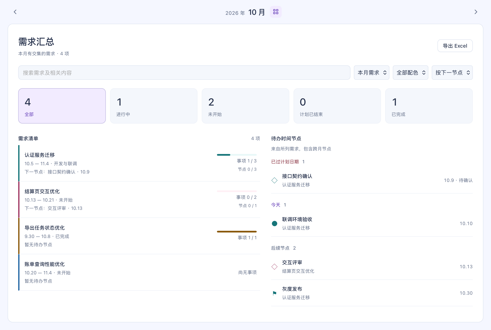

搜索支持需求、阶段、节点、工作事项、资料名称、类型和链接。多个关键词用空格分开时需同时匹配；中文输入完成后再筛选，不会在输入法组合过程中替换输入框。在汇总中按 `Command/Ctrl + F` 聚焦搜索，按 `Esc` 清空搜索词；“清除筛选”会清除搜索、配色和状态条件，保留已经选择的范围与排序。

打开详情时，汇总保留当前需求的配色提示。完成事项或节点后关闭详情，焦点回到对应需求；已完成节点从待办列表移除后，返回其所属需求。空结果会提供对应入口：清除条件、查看全部需求或返回日历。Excel 导出提示悬浮在页面上，不改变日历和表单高度；可以随时关闭，取消保存窗口不会显示失败，也不会覆盖数据保存问题的说明。

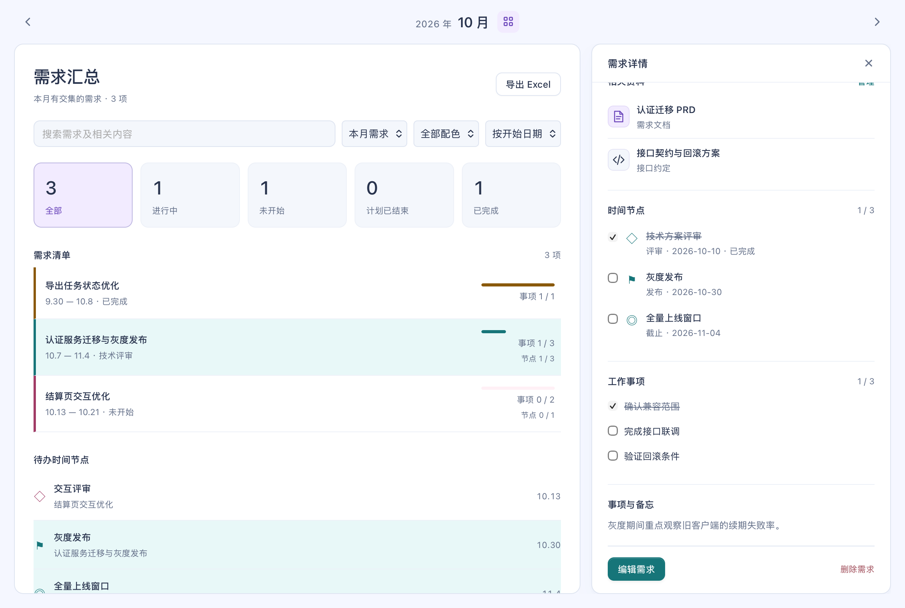

*探索版实际桌面截图：节点与事项在详情中统一管理，长内容在面板内部滚动。*

### 明亮的浅色界面与开场翻页

白色日历和详情面板搭配浅蓝白背景，提供鸢尾紫、晴空蓝、薄荷绿、琥珀黄、蔷薇粉、湖水青、杏子橙和雾霭灰八种配色；新建时自动选择使用较少的颜色，也可以手动选择。外层面板、输入框、日期组和需求条采用一致的边缘层次：细边框、平滑圆角与轻阴影，跨周延续的端点保持平直。界面保持浅色，不随系统切成深色。

打开应用时，小日历以明快色块呈现一次简洁翻页，再淡入月历，全程约 **0.74 秒**。不会循环播放或延迟数据载入；点击或按键立即跳过，操作继续生效。系统开启“减少动态效果”时直接进入日历。切换月份或打开详情不会重播开场。

日常操作使用短过渡：点击需求只改变同色反馈，日期范围条平滑跟随拖动，详情展开和收起连贯衔接。资料、阶段的展开可随连续操作反向切换。

### 月历中的完整需求周期

月历是默认主视图。每个需求拥有开始与结束日期，既能安排单日修复，也能覆盖跨周、跨月的长期开发。同一时间推进的多个需求会分行显示，方便观察排期重叠与交付周期。长条圆角端表示实际起止，平直端表示延续到相邻周；标题与条内阶段分为两行显示。

跨年需求会在详情、阶段日期和长条悬停信息中显示起止年份；当前年度内的短周期保持简洁日期。较长的阶段名称、技术事项和自定义资料类型可以完整换行，避免在窄详情面板中被裁掉。

每周按实际重叠安排需求行位，短期事项结束后不会在后续周留下空行；跨周需求在空间允许时延续原位置，同日起始的较长周期优先靠上。历史需求不会挤占当前月份。真正密集的一周仍完整展示，并可在日历区域内滚动；滚动浏览密集排期时，所在周的日期保持在星期标题下方，进入下一周后自然接替。详情面板单独滚动，键盘移动日期焦点时会将目标日期滚动到可见位置。切换月份从首周开始；定位需求时会切换到其起始月份，并将对应长条滚动到可见位置。

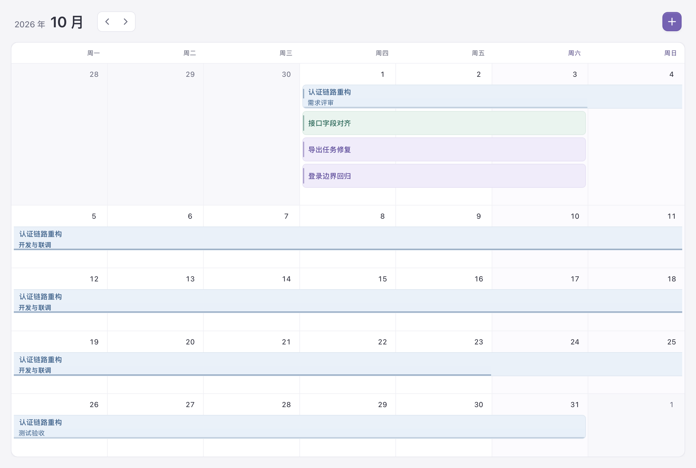

*桌面版实际运行截图：三个短期事项与一个长期需求，整个月保持可见；较零碎的评审、开发与验收日期仍标在同一需求条内。*

<details>
<summary>查看密集排期的滚动阅读</summary>

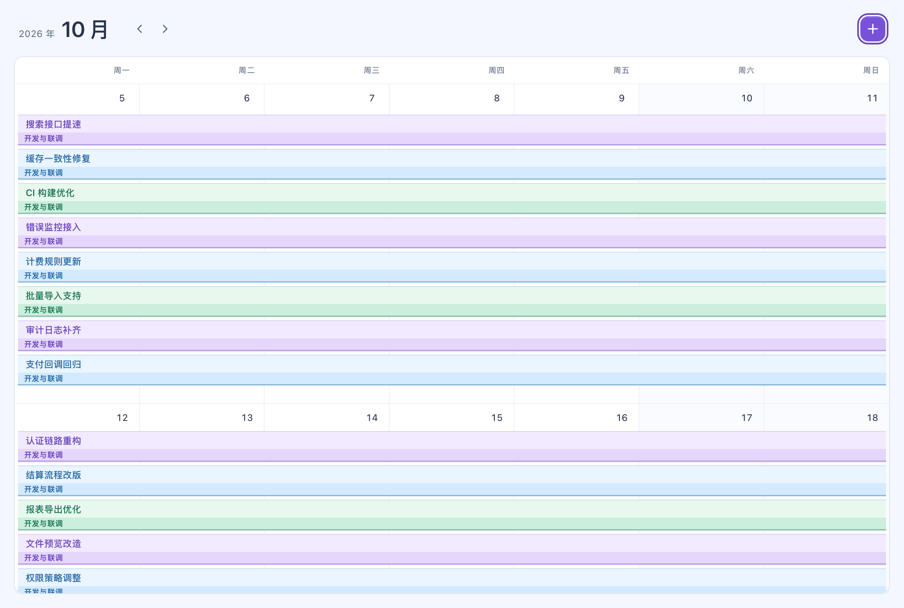

*桌面版实际运行截图，使用 14 个长期需求演示；日期随所在周保持可见，完整需求与条内阶段继续展示。*

</details>

顶部使用小字号年月，月份居中，上个月和下个月按钮分列左右。点击年月即可选择目标年月，或回到本月；正在编辑的表单和阅读位置会保留。只有创建或打开具体需求时才展开详情，把日常浏览空间留给日历。打开或编辑需求后，该需求的跨周长条会保持轻量选中提示，便于对应右侧内容；关闭详情后清除。

### 阶段直接显示在需求条内

评审、开发、联调、测试、上线等阶段属于同一个需求。长条上层展示需求名称，下层以同色系的分段底色、阶段文字和细时间线对应日期，当前阶段稍深；阶段之间的空档继续保留在需求长条中。阶段名称可以自定义，不需要把每个阶段再建成独立日历事项。

阶段详情与编辑使用一致的纵向时间轴。编辑时，名称和日期沿轴线对齐，跨年日期完整显示，长名称按需换行；展开的阶段以需求配色标明，名称及起止日期缩进在同一层，其余阶段保持折叠。

<details>
<summary>查看阶段编辑与跨年安排</summary>

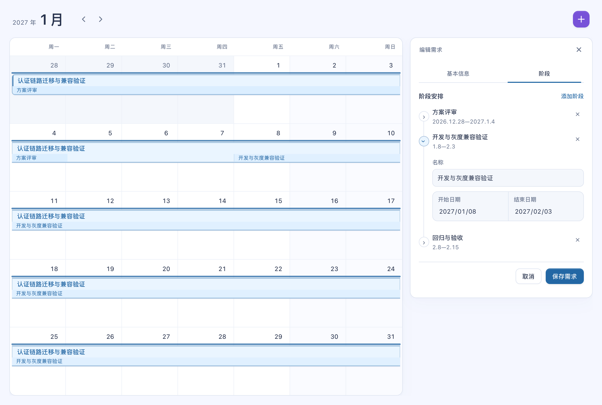

*桌面版实际运行截图：需求跨越年末与两个后续月份，阶段间允许保留空档；编辑时持续保留对应日期条。*

</details>

例如，“结算流程改版”可以持续数周，内部依次安排“评审 → 开发 → 联调 → 测试 → 上线”。在编辑表单的 **阶段安排** 中设置各阶段日期；保存时会检查阶段是否超出需求周期，以及是否互相重叠。


*功能示意图，用于说明跨周需求与内部阶段的关系；实际界面见上方运行截图。*

### 标记评审、发布和截止节点

除了持续几天的阶段，还可以添加发生在某一天的时间节点。节点有 **评审 ◇、发布 ⚑、截止 ◎、检查点 ●** 四种类型，名称、日期和完成状态都可以编辑。节点必须落在需求周期内；未完成且计划日期已过的节点，会在详情中明确提示，并使用虚线标记区分；同一天有多个节点时，在需求条内显示数量，悬停可查看各节点的完整信息，详情中逐项展示。

节点直接标在原来的需求长条中，不增加日历行。点击条内标记或汇总中的节点，详情会滚动到对应节点并轻量突出显示，不会自动勾选完成。同日聚合标记优先定位该日第一个未完成节点。已完成节点有独立的完成样式；拖动整条需求改期时，节点与阶段一起按相同天数平移。

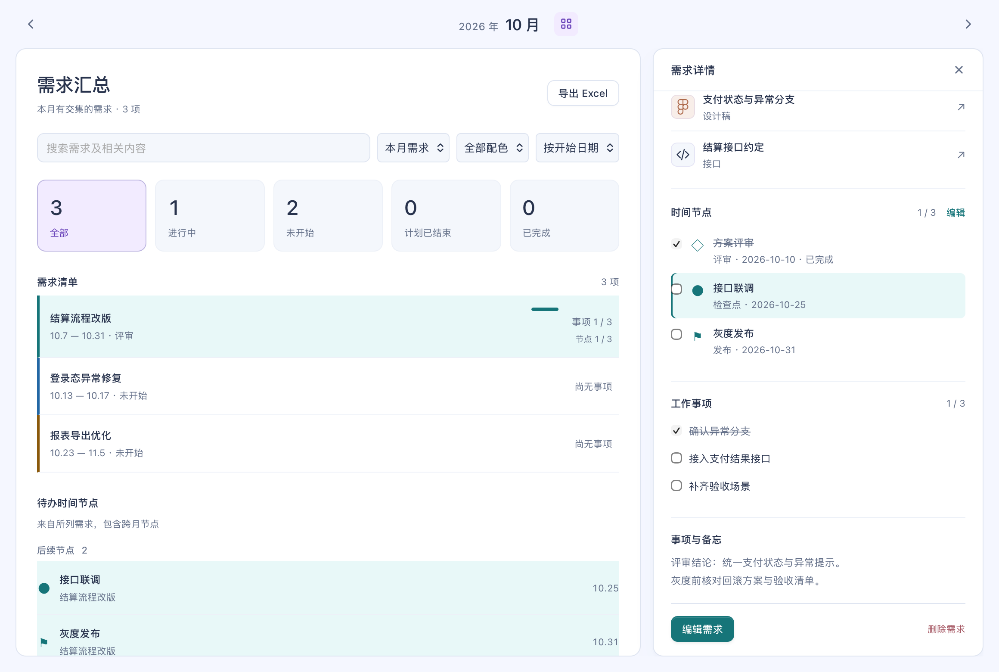

### 从汇总观察所有需求

点击年月右侧的小方格图标，进入 **需求汇总**，再次点击返回月历。默认只看与当前月份相交的需求，也可以切换为全部需求，并按关键词、配色、状态筛选，按开始日期、结束日期或事项完成率排序。搜索覆盖需求名称、备忘、阶段、节点和资料名称。

汇总区显示需求清单、工作事项完成进度和待办节点；点击任意需求或节点，在旁边查看详情。勾选工作事项后，进度同步更新。排期已结束与实际已完成分别统计，避免把日期结束误认为交付完成；已完成要求至少有一个事项或节点，且全部勾选完成。

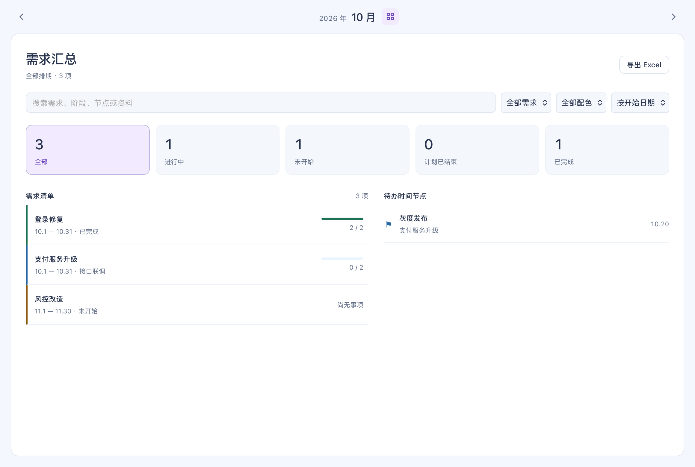

*桌面版实际运行截图：当前为全部需求范围，展示进行中、未来排期和已完成需求。*


节点列表可按 **评审、发布、截止、检查点** 筛选，并选择 **未来 7 天、未来 30 天、已过计划日期或所选月份**。未来 7 天包含今天至第 6 天，未来 30 天包含今天至第 29 天。可切换待办、已完成和全部状态，已完成节点单独分组，按节点的计划日期回顾。筛选只作用于节点列表；Excel 仍包含所列需求的完整排期与全部节点。空结果可以单独重置节点筛选，保留需求搜索、配色、状态和排序。

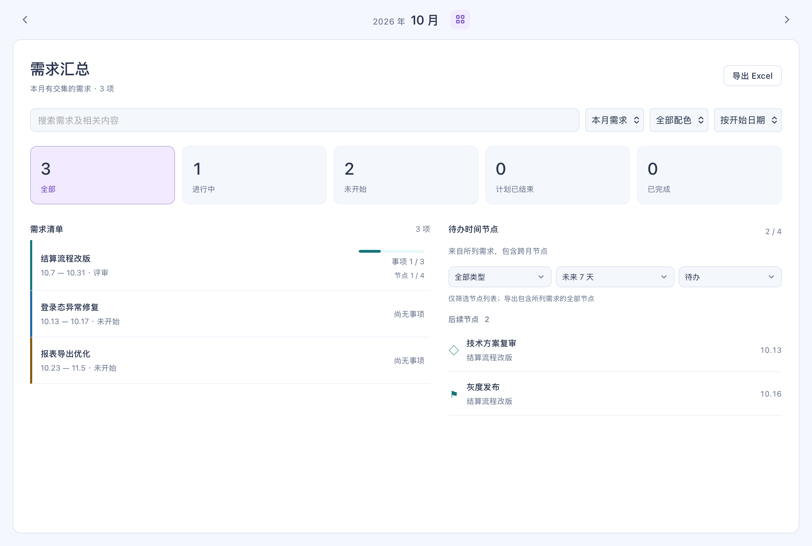

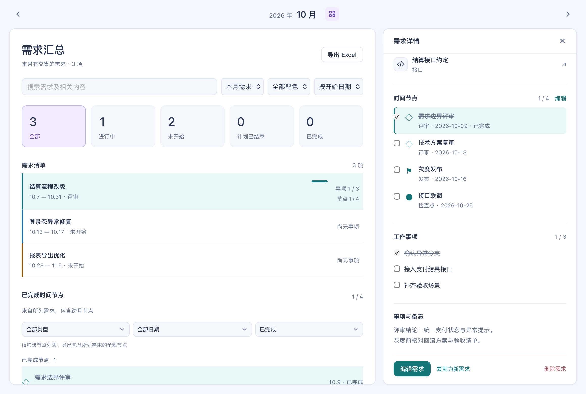

### 导出 Excel 排期

桌面版使用 **文件 → 导出 Excel 排期…** 导出所有已保存需求；汇总右上角的 **导出 Excel** 只导出当前筛选结果。浏览器版也可从汇总页面下载。选择保存位置即可获得 `.xlsx` 文件，导出过程不需要联网。

工作簿包含五张表：

| 工作表 | 内容 |
| --- | --- |
| 需求汇总 | 需求名称、起止日期、自然日跨度、状态、当前阶段、事项完成率、下一待办节点、提醒和备忘 |
| 时间节点 | 所属需求、节点名称、类型、日期、完成状态 |
| 阶段排期 | 所属需求、阶段名称、起止日期和跨度 |
| 工作事项 | 所属需求、事项内容、顺序及完成状态 |
| 相关资料 | 所属需求、资料名称、自定义类型和链接 |

每张表保留需求标识用于关联，提供筛选和冻结表头。日期、提醒时间与完成率按对应的数据类型导出，便于排序；1900 年之前的日期保留为完整文本。超出 Excel 单元格长度的内容放入带“续”标识的列，保留原文。以 `=` 开头的名称按普通文字保存。导出前需先保存或取消当前草稿。

Excel 用于查看、筛选和分享排期，暂不支持导入；迁移或恢复完整应用记录请使用 JSON 备份。

### 拖动长条重新排期

跨周片段会作为同一个需求响应悬停和按下：边线统一变化，按下时底色轻微加深。长条保持原来的位置与尺寸，便于连续阅读；键盘焦点使用需求自身的配色。

按住现有需求长条，拖到目标日期，即可整体调整周期；从跨周长条的中间位置抓取也可以。所有阶段与时间节点按相同天数平移，保留原有时长与阶段空档。靠近日历上下边缘时会自动滚动，方便在密集排期中选择目标日期。

松手后进入编辑草稿，核对后保存才会修改原排期。资料、事项完成状态和备忘一并保留，明确设置的提醒时间保持原值，可以在编辑表单中单独调整。拖动时按 `Esc`、窗口失焦或在日历外松手会取消；已有未保存的编辑不会被新拖动覆盖。

<details>
<summary>查看重新排期后的编辑草稿</summary>

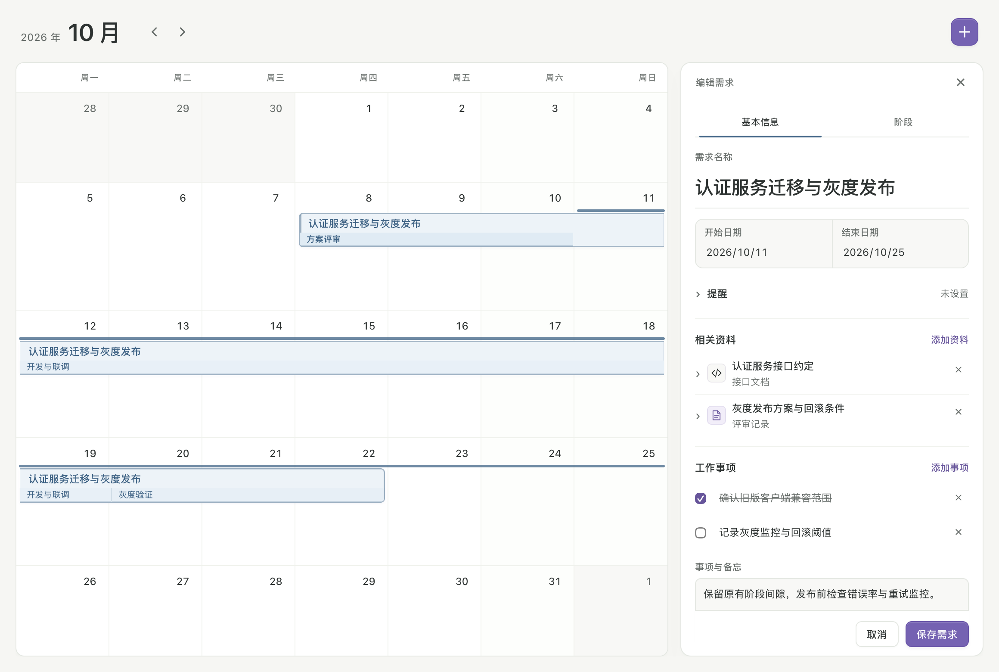

*桌面版实际运行截图：示例需求从 10 月 8–22 日顺延至 11–25 日，阶段同步顺延；截图展示松手后的未保存草稿。*

</details>

### 一个需求，一处资料

在编辑表单的 **相关资料** 中集中保存 PRD、设计稿、接口约定、代码仓库或问题记录。每份资料的名称、类型和链接都可以自行填写，按需添加、修改和移除。

| 示例名称 | 自定义类型 | 可填写的内容 |
| --- | --- | --- |
| 结算改版 PRD | 需求文档 | 钉钉文档等在线文档地址 |
| Checkout 交互与视觉 | 设计稿 | Figma 等设计稿地址 |
| 支付接口约定 | 接口 | 接口文档地址 |
| 上线前检查 | 检查清单 | 可只填写名称和类型，链接留空 |

链接支持 `http://` 和 `https://`。桌面版点击资料链接后，由系统默认浏览器打开。资料编辑行以图标、名称和类型分层展示，名称与自定义类型可以完整换行；展开的名称、类型和可选链接与摘要文字对齐，较长列表在面板内部滚动。详情底部保留编辑和删除操作；资料较多时也可以直接进入编辑，取消后回到原阅读位置。

资料和阶段以短暂的高度过渡展开、收起，连续点击可从当前高度反向切换；同组切换时，其余条目自然收回。新增条目或定位校验错误时立即展开，输入不需要等待动画。系统开启“减少动态效果”时直接切换，折叠不会清除已经填写的内容。

<details>
<summary>查看资料编辑</summary>

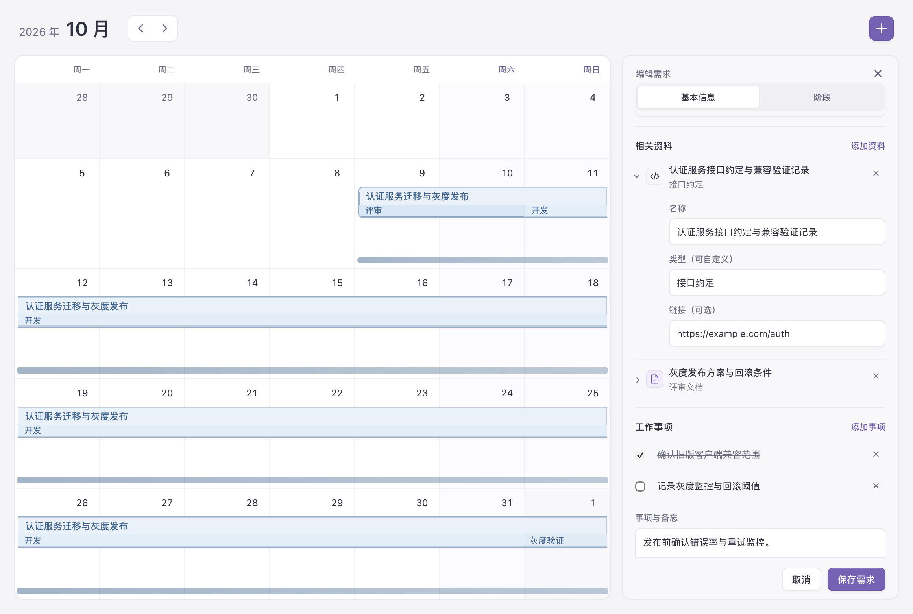

*桌面版实际运行截图，使用示例接口地址展示资料编辑，内置图标保持名称和类型的识别。*

</details>

桌面版会自动获取 HTTPS 网站的图标：检查公开主页声明的图标，并提前准备默认 favicon 作为后备。快速返回的主页图标会优先使用；主页或图标服务器较慢时，先使用可用的默认 favicon，避免逐个等待超时。资料区先显示内置类型图标，获取成功后原位替换；详情与编辑行都使用相同图标，行高保持稳定。修改链接后，旧图标不会覆盖新链接。 未填写链接的资料会随类型变更更新内置图标；原有自定义文字标记会保留。

请求只使用网站公开主页与图标地址，不携带文档路径、链接参数或浏览器登录信息；不会读取文档内容，也不接入浏览器标签页。图标仅在应用运行期间缓存。离线、站点限制访问、HTTP 链接或不支持的图片格式会继续使用内置图标；浏览器版始终使用内置图标。


*桌面版实际运行截图，展示钉钉文档与 Figma 的内置类型图标；联网时会尝试替换为对应网站图标。标题、周期、阶段、资料与事项按阅读顺序分层，查看详情时保留月历上下文。打开与关闭面板采用连贯过渡，并支持系统减少动态效果偏好。*

### 工作事项、进度与备忘

把需求拆成可勾选的工作事项，记录完成数量；用备忘保存评审结论、阻塞原因、接口约定和验收注意点。详情同时展示阶段安排与当前阶段，方便恢复上下文。长条、详情状态与当前阶段沿用同组需求配色；未开始或计划已结束使用中性提示，具体状态以文字为准。

编辑列表使用统一的行末移除图标，悬停提示会注明对应资料、阶段或事项名称；删除后焦点移至相邻条目，最后一项删除后回到添加入口。完成事项在详情与编辑中均保留勾选和弱化文字，方便区分待办。

新建与编辑使用同一个连续表单：需求名称、开始与结束日期、提醒、阶段安排、时间节点、相关资料、工作事项和备忘依次展示，无需切换页签。面板默认与月历等高，内容较少时也会填满可用高度，保存与取消保持在底部；内容较多时只在面板内部滚动。添加资料、阶段或事项时，新输入框会自动聚焦并进入可见区域。从详情进入阶段编辑、节点编辑或资料管理时，直接定位到对应部分。新增阶段默认选择当前周期内最早尚未安排的日期，周期已排满时保留空日期供手动调整；新节点默认使用周期内的今天，尚未开始时用开始日期，已结束时用结束日期。日期以表单内当前修改为准。

空栏目采用紧凑的行高和细分隔线，名称与日期保留清晰的层级。底部操作区固定在面板边缘，滚动长资料列表时也能直接保存或取消。

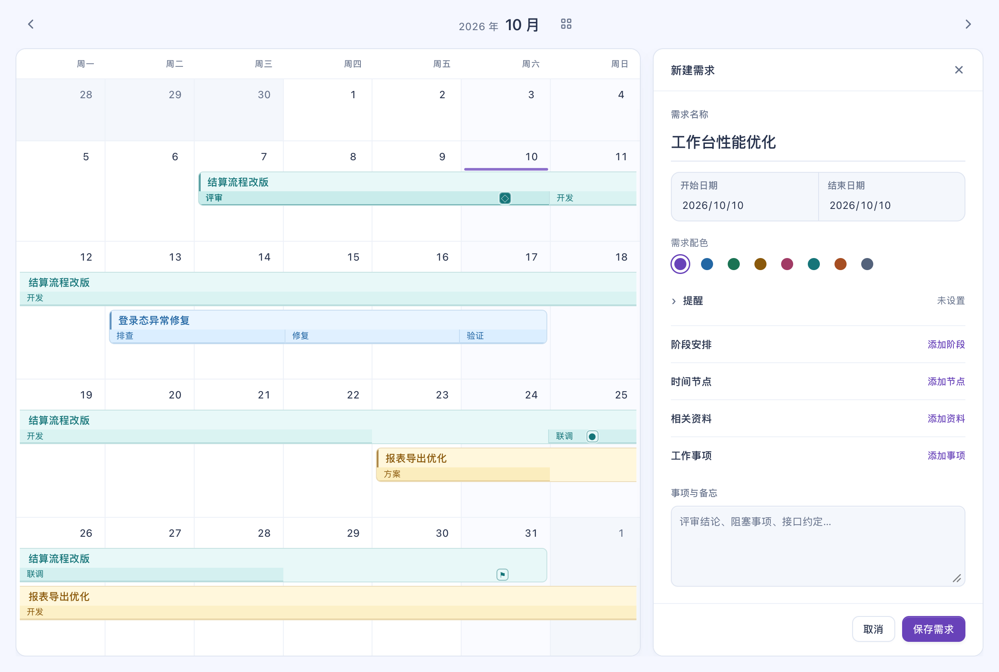

*桌面版实际运行截图：新建表单占满可用高度，各部分使用轻分隔线依次展示；保存按钮、勾选框、添加操作与输入焦点沿用当前需求配色，月历上的范围条持续可见。*

备忘保留缩进、换行与首尾空白，便于记录代码片段和接口约定。输入区利用表单剩余空间，并随内容适度增高；较长内容在输入区内滚动；也可以手动调整高度，当前编辑会保留你的设置。窗口变窄时，会按新的宽度重新排版。较长的签名文档链接也会完整保存。校验失败时，会展开并定位需要修正的具体字段。

<details>
<summary>查看多行备忘编辑</summary>

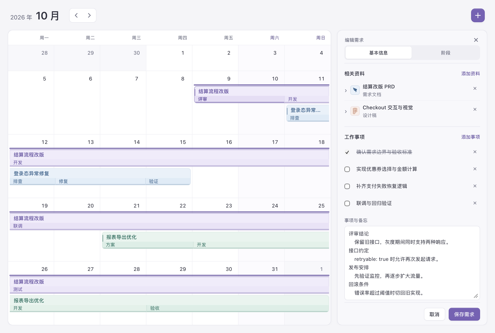

*桌面版实际运行截图：8 行备忘随内容增高，保存操作与月历日期条保持可见。*

</details>

### 直接在日历上创建排期

点击空白日期即可新建当天需求；拖过一段日期即可创建对应周期。支持反向拖动和跨周拖动，以最终松手的位置确定范围，系统会整理起止日期。拖到星期标题或日历外松手会取消；拖动时按 `Esc` 或窗口失焦也会取消，随后松手不会误建需求。也可以使用 `⌘N` 或桌面版的 **文件 → 新建需求**，再填写日期。

新需求从八种配色中自动选择当前月历里使用较少的一种，便于区分并行排期；已有需求保留自己的颜色。创建时使用同色细条在日期行下方反馈范围，密集月历中会随该周日期一起保持可见。松开鼠标后，范围条持续显示。修改日期时，暂时清空字段或输入起止顺序不完整，会保留最后一次有效范围；日期重新有效后再更新。放弃编辑时清除，保存后由同色正式需求条接替。点击与拖动使用简短动画，并尊重系统“减少动态效果”偏好。

### 桌面操作与未保存保护

macOS 版使用 AppKit 原生窗口，Windows 版使用 Electron 独立桌面窗口，两者均提供系统菜单，支持剪切、拷贝、粘贴、全选与文字撤销。

右键点击需求条可打开系统菜单，查看、编辑或删除需求。视图菜单提供全屏入口；macOS 版会记住窗口尺寸。

| 快捷键 | 操作 |
| --- | --- |
| `⌘N` | 新建需求 |
| `⌘S` | 保存当前编辑 |
| `⌘W` | 关闭详情 |
| `⌘Z` | 在编辑器外撤销最近一次删除；文字编辑中保留系统文字撤销 |
| `⌃⌘F` | 切换桌面窗口全屏 |
| `⌘⌥←` / `⌘⌥→` | 切换月份 |
| `Esc` | 取消拖动或关闭详情 |
| 日期聚焦后按方向键 | 左右移动一天，上下移动一周 |

Windows 中将 `⌘` 换成 `Ctrl`、`⌥` 换成 `Alt`。全屏使用 `F11`，退出窗口使用 `Alt+F4`。

切换需求或关闭编辑器时，如果有未保存内容，会询问保存、不保存或继续编辑。桌面版关闭窗口、退出应用时也提供原生保存提示。保存失败会保留表单并显示原因，便于修复后重试。

删除需求后可撤销最近一次删除；退出应用后不保留撤销记录。界面统一使用浅色外观，包括系统深色模式下的月历与日期输入控件。

### 按需开启系统提醒

桌面版 编辑表单的 **提醒** 默认收成一行，明确显示“未设置”；已有提醒会直接显示实际的本机日期与时间。点击该行展开日期控件，选择时间后保存。仅展开不会自动设置时间或申请通知权限；首次保存带有未来提醒时间的需求时，才会请求 macOS 通知授权。

允许后，提醒由 macOS 本地通知系统安排。修改时间会替换原提醒；展开后点击 **不提醒** 并保存，即可取消原提醒。清除时间先保留为草稿，未保存时原提醒继续有效。删除需求会取消提醒，撤销删除会恢复尚未到期的提醒。点击通知会打开对应月份与需求；遇到未保存内容时先保护草稿。

Windows 安装版使用系统的 `ScheduledToastNotification` 安排未来提醒，正常退出应用后仍由系统管理。修改、取消和删除需求会同步更新系统中的安排；点击通知会启动或唤起应用，定位对应需求，并保护正在编辑的草稿。通知被禁用或系统安排失败时，会单独显示原因，已保存的需求不受影响。

请在 **Windows 设置 → 系统 → 通知** 中允许“需求日历”。勿扰模式、睡眠及关机会影响展示；Windows 的定时通知只有约 5 分钟的投递窗口，关机超过该窗口可能丢弃提醒，应用不会把错过的提醒全部补发。改变系统时区后，请重新打开应用以重新核对本机提醒时间。参见 [Microsoft 定时通知说明](https://learn.microsoft.com/en-us/windows/apps/develop/notifications/app-notifications/app-notifications-scheduled)。

<details>
<summary>查看提醒设置界面</summary>

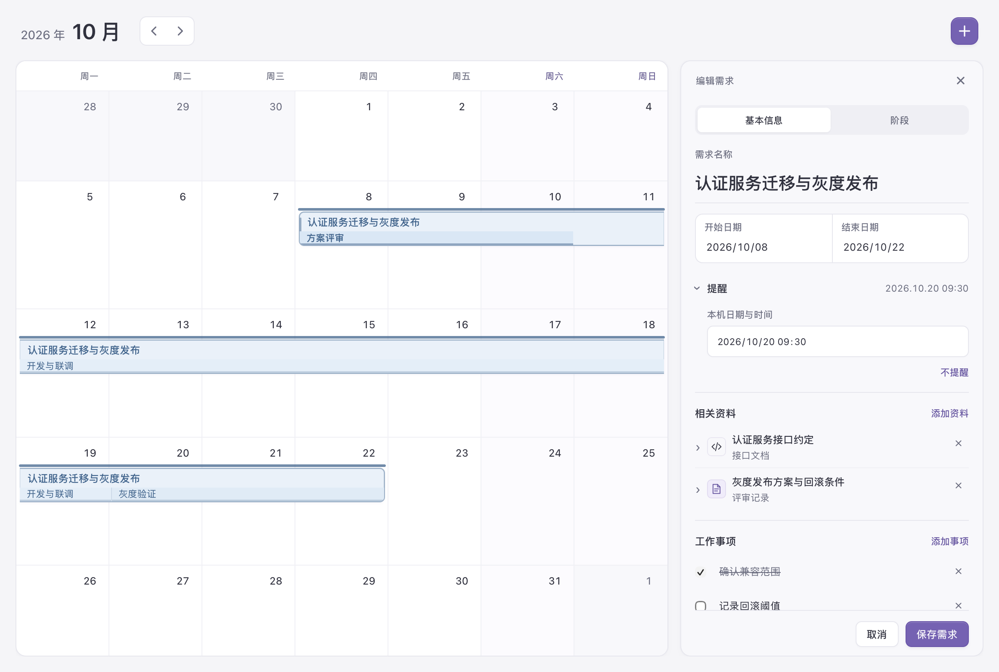

*桌面版实际运行截图：已保存的示例提醒处于展开查看状态，展开本身不会修改时间。*

</details>

需求会先保存到本机，通知授权或调度等待不会锁住编辑器；提醒状态会单独显示。拒绝授权也不会阻止需求保存。可稍后在 **系统设置 → 通知 → 需求日历** 中允许通知；专注模式与系统通知设置会影响横幅和声音。

> 提醒调度逻辑已通过隔离适配器测试，经用户允许后已开启验收副本通知，系统日志确认实际进入通知中心；横幅/声音受到共享屏幕设置抑制，真实点击定位仍待界面验证。浏览器版不提供此能力。

## 第一次使用

以“结算流程改版”为例：

1. 在月历中拖出整个交付周期，填写需求名称并确认起止日期。
2. 在相关资料中添加钉钉 PRD、Figma 设计稿与接口文档，自行命名资料类型。
3. 添加“确认验收标准”“实现核心逻辑”“完成回归”等工作事项。
4. 在同一表单的阶段安排中填写评审、开发、联调与测试的日期，并按需添加发布或截止节点。
5. 如需提醒，在桌面版中设置提醒时间，然后保存。
6. 日常从月历点击需求，勾选完成事项，补充进展和阻塞信息。

用 Tab 聚焦日历日期后，可用方向键按天或按周移动，Home / End 到本周周一或周日，Page Up / Page Down 到上月或下月的同一天；遇到短月份自动落到月末。日期移动本身不会创建需求，Enter 或空格才打开新建表单。

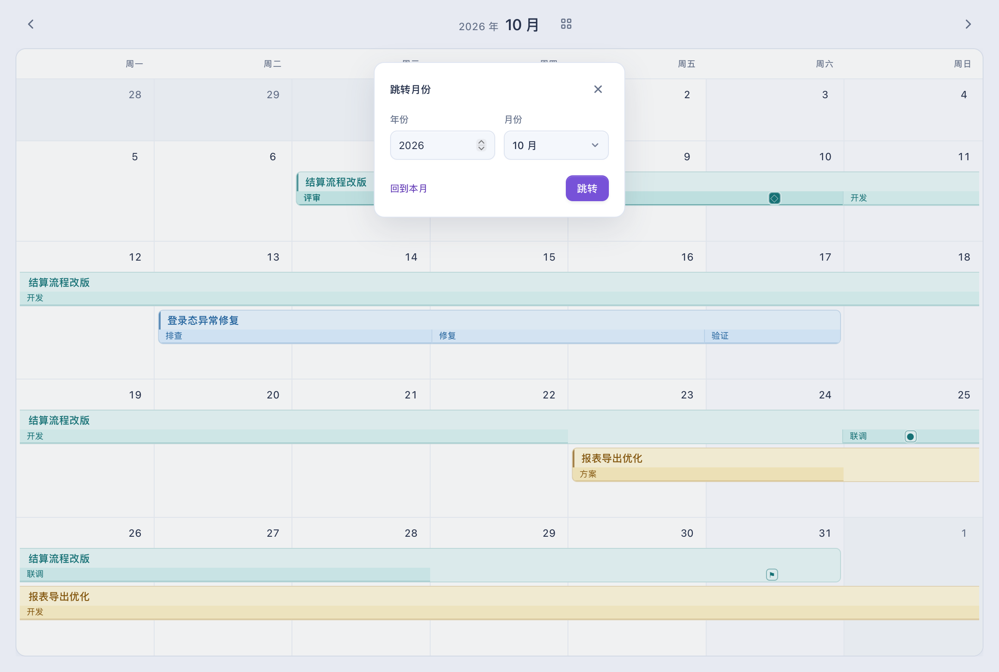

### 复用已有需求

在需求详情底部选择 **复制为新需求**，会创建一个可编辑的副本，并把完整周期平移到今天：阶段时长、间隔和节点相对位置保持，配色、资料、事项文字和备忘保留，工作事项与节点完成状态归零，提醒清空。副本使用独立标识；点击保存后才写入本机数据，取消时可选择保留或丢弃草稿。超出支持日期范围时会提示错误，原需求保持不变。

连续表单的阶段、节点、资料和事项标题旁显示条目数量，增删即时更新，空栏目不显示零。

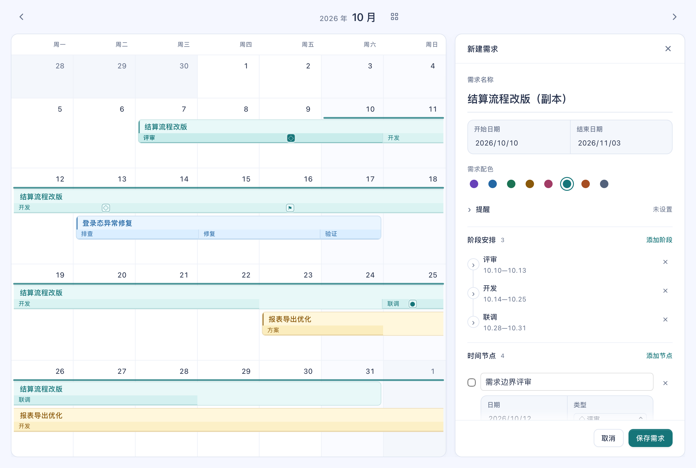

## 数据与备份

### 数据保存在哪里

macOS 原生版保存在本机独立目录：

```text
~/Library/Application Support/RequirementCalendar/
├── calendar.json            # 当前需求数据
└── calendar.last-good.json  # 最近一次有效备份，保存后产生
```

数据采用原子写入，并保留有效备份。发生损坏时会保留原始记录再进行恢复；多个应用进程之间也会检查过期写入，避免旧窗口直接覆盖新数据。首次启动新版桌面应用时，会迁移旧版 WebKit 记录并保留旧记录。

Windows 版位于 `%APPDATA%\RequirementCalendar\data\`，同样保存 `calendar.json` 和 `calendar.last-good.json`。恢复或覆盖损坏记录前，原文件另存为 `calendar.preserved-*.json`。程序只允许一个桌面实例，并在写入前检查文件是否被其他程序修改；检测到冲突会保留编辑内容并拒绝覆盖。可通过 **文件 → 打开数据文件夹** 定位。Electron 开发预览在 Mac 上使用 `~/Library/Application Support/RequirementCalendar/data/`，与原生版文件分开。

浏览器版使用该浏览器、该地址下的 `localStorage`。清理浏览器数据、隐私模式或切换访问地址可能影响记录。桌面版与浏览器版之间不会自动同步。

### 导出与恢复

桌面版的 **文件** 菜单提供：

- **导出 Excel 排期…**：导出全部已保存需求、节点、阶段、事项和资料，便于分享与筛选。
- **导出备份…**：使用系统保存窗口，将全部已保存需求导出为 JSON。
- **从备份恢复…**：选择 JSON，校验并确认后替换当前记录。
- **显示数据文件夹**：在 Finder 中定位本机数据与自动备份。

导出或恢复前，先保存或取消当前编辑。恢复会替换全部需求，建议先导出当前版本；无效格式、重复标识、重叠阶段等内容会被校验拦截。

恢复前的记录会额外归档：macOS 原生版使用 `calendar.before-restore-*.json`，Windows 版使用 `calendar.preserved-*.json`，后续正常保存不会替换这份归档。

当前数据格式为 v7，支持读取 v4–v6 的已有数据；新版保存后请继续使用新版，旧版会拒绝覆盖更高版本的数据。

自动备份与主文件位于同一目录，建议定期导出到其他位置。需求不会自动上传到 GitHub，也没有云端同步服务。

## 常见问题

### 能直接下载安装吗？

Windows 可以从上方 GitHub Actions 构建产物下载 `.exe` 安装包。macOS 仍需从源码构建，尚未提供 DMG、公证安装包或 Homebrew 安装。两者目前都没有自动更新。

### 为什么没有收到提醒？

确认使用桌面版、设置了未来的提醒时间并已保存，再检查 macOS 是否允许“需求日历”发送通知，以及专注模式是否限制展示。本机验收已确认实际进入通知中心；共享屏幕时可能静音且不显示横幅，点击通知仍待界面验证。

Windows 请确认运行的是安装版，并检查系统通知、勿扰模式和电脑在提醒时是否开机。Windows 实际横幅、睡眠唤醒和通知点击仍需在真实 Windows 10/11 设备上验收；构建和自动测试不能代替这些系统行为检查。

### 支持钉钉或 Figma 自动同步吗？

可以保存并打开相关链接；桌面版自动获取公开网站图标，失败时使用内置矢量图标。尚未读取文档内容、接入浏览器标签页或同步外部平台。

### 还有哪些能力尚未提供？

当前没有系统日历同步、菜单栏常驻、开机启动、团队协作与云端同步。需求数量没有固定的 16 条限制，实际容量受设备和存储空间影响。

## 开发

```text
requirement-calendar/
├── index.html       # 可直接打开的离线页面
├── src/             # 页面结构、样式、交互、数据模型与存储
├── native/          # AppKit 窗口、菜单、文件存储与系统提醒
├── electron/        # Windows 桌面宿主、安全桥接、文件存储和定时提醒
├── package.json     # Electron 启动与 NSIS 安装器配置
├── .github/workflows/ # Windows 自动构建、测试和安装包产物
├── scripts/         # 页面与 macOS 应用构建脚本
├── tests/           # 模型、构建、原生与 WebKit 回归
├── docs/            # 优化记录与验证证据
└── assets/          # 马赛克图标、实际截图与功能示意图
```

修改 `src/` 后重建离线页面，修改原生代码后重新构建应用：

```bash
python3 scripts/build.py
scripts/build-macos.sh
```

数据模型与构建测试需要 Node.js 和 Python 3：

```bash
node --test tests/model.test.cjs tests/startup.test.cjs
python3 tests/build.test.py
```

Electron 桌面相关测试执行 `npm test` 与 `npm run test:desktop`。后者使用独立临时数据目录，不读取现有需求，不注册真实提醒；覆盖沙箱隔离、桥接校验、原子保存、重载、草稿保护及备份恢复。Windows 工作流还校验 PowerShell / WinRT 类型和快捷方式通知标识，对打包后的 `.exe`、经 NSIS 实际安装后的应用分别执行桌面测试，并核对开始菜单与通知点击协议。定时提醒由固定 PowerShell 脚本调用 WinRT，需求内容通过 JSON 标准输入传入，详情见 [Windows 实现与验收](docs/WINDOWS_DESKTOP.md)。

网站图标还提供独立的联网检查命令，需先构建桌面版：

```bash
./scripts/verify-site-icons.sh
```

该命令使用隔离的示例数据，检查钉钉、Figma 和 GitHub 的图标在不同系统外观偏好下的浅色界面中的加载、编辑复用与行高稳定性；结果和实际截图保存在 `.build/site-icons-live/`。普通桌面回归默认关闭网络，运行这个命令会显式开启公开图标请求。站点或网络不可用时，该检查会报告失败，应用仍保留内置资料图标。

详细改动与验证范围见 [优化记录](docs/OPTIMIZATION_LOG.md)。README 图标通过内置 imagegen 生成，生成提示词见 [图标说明](assets/icon-v2-prompt.md)。运行截图与功能示意图已分别标注。
