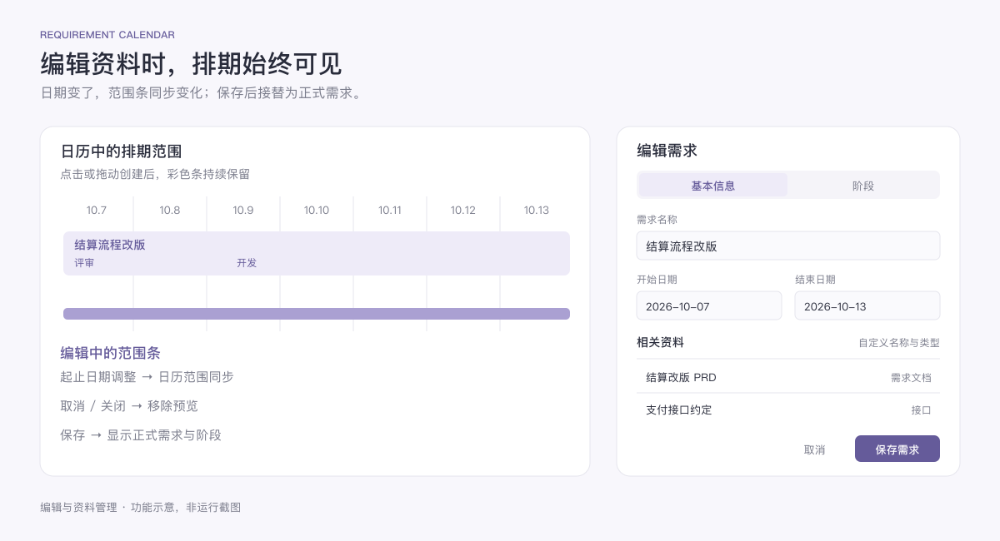

<p align="center">
  
</p>

<h1 align="center">需求日历</h1>

<p align="center">把排期、阶段和资料，放回同一条需求里。</p>

需求日历面向需要同时推进多个需求的程序员：用月历观察交付周期，用连续长条展示需求，在条内区分评审、开发、联调和测试，再把文档、设计稿、接口约定与备忘集中到需求详情中。

当前提供可在浏览器中运行的交互原型，无需安装 Node.js 或构建依赖。macOS 原生安装包和系统通知将在后续应用工程中实现。


*功能示意图：说明排期与阶段的关系，非运行截图。*

## 安装与启动

### 环境要求

- 使用近期版本的 Safari、Chrome 或 Edge。
- 下载文件后即可本地打开；核心日历功能不需要后端服务。
- 本仓库为私有仓库，下载或克隆时需要具有读取权限的 GitHub 账号。

### 方法一：下载 ZIP

1. 登录 GitHub，打开 [requirement-calendar 仓库](https://github.com/11eleve/requirement-calendar)。
2. 点击 **Code → Download ZIP**，下载并解压。
3. 在解压后的目录中找到 `index.html`，双击并选择浏览器打开。
4. 首次打开时会看到示例需求，可直接点击查看或编辑，也可创建自己的排期。

请打开根目录的 `index.html`。`src/calendar.html` 是界面源码片段，供开发时阅读与修改。

### 方法二：通过 Git 克隆

先完成本机 Git 对 GitHub 的认证，再执行：

```bash
git clone https://github.com/11eleve/requirement-calendar.git
cd requirement-calendar
open index.html
```

`open` 为 macOS 命令；其他系统可在文件管理器中打开 `index.html`。

### 可选：通过本地 HTTP 服务运行

如果希望以固定的本地地址访问，且已安装 Python 3，可在项目目录执行：

```bash
python3 -m http.server 8080 --bind 127.0.0.1
```

然后在浏览器打开 [http://127.0.0.1:8080](http://127.0.0.1:8080)。在终端按 `Ctrl+C` 停止服务。

这是本机静态文件服务，不会同步需求到 GitHub。建议始终使用同一种打开方式和同一个地址，以保持浏览器存储位置一致。

## 功能

### 月历排期

月历是主视图，顶部箭头用于切换月份，加号用于新建需求。平时保留完整日历空间，创建需求或点击已有需求后再展开详情面板。

需求由开始日期和结束日期定义，可以持续一天，也可以跨周、跨月；同一时间有多个需求时，长条分行排列。较长的交付周期和短期修复都能放在同一张日历中查看。

### 点击与拖动创建

| 操作 | 结果 |
| --- | --- |
| 点击空白日期 | 创建当天的需求，并预填起止日期 |
| 从开始日期拖动到结束日期 | 创建覆盖整个范围的需求 |
| 反向拖动或跨周拖动 | 自动整理起止日期，跨周延续范围条 |
| 点击顶部加号 | 打开新建表单，手动设置周期 |

点击和拖动使用彩色条反馈，日期格子不会整块变色。松开鼠标后，范围条会在编辑期间持续显示；修改起止日期时同步变化，取消或关闭编辑时清除，保存后由正式需求条接替。按 `Esc` 可以取消正在进行的拖动。



*功能示意图：范围条随日期调整，资料与基本信息集中管理。*

### 在需求条内安排阶段

评审、开发、联调、测试和上线等阶段，直接显示在原需求长条内部。阶段名称可以自定义，无需再创建独立日历事项。

在编辑面板的 **阶段** 页中添加名称与起止日期。阶段日期需要落在需求周期内，同一需求的阶段不能互相重叠。保存前会检查这些规则，并提示需要修改的字段。

例如，一个持续数周的结算改版，可以在同一条中依次展示“评审 → 开发 → 联调 → 测试 → 上线”，点击后查看完整阶段安排。

### 按需求集中管理资料

资料放在 **基本信息** 中，每份资料都可以设置：

| 字段 | 用途 |
| --- | --- |
| 名称 | 自定义资料标题，如“结算改版 PRD”或“支付接口约定” |
| 类型 | 自定义分类，如文档、设计稿、接口、问题记录 |
| 链接 | 可选，填写 `http://` 或 `https://` 地址 |

可以添加、编辑和移除资料，没有固定的 PRD 或设计稿字段。资料行默认紧凑展示，展开后编辑具体内容；较长的资料列表在面板内滚动。

当前根据链接或类型展示钉钉、Figma、代码等简化标识，尚未获取真实的网站 favicon 或浏览器标签页图标。

### 进度与事项

需求详情展示当前阶段、阶段日期、工作事项的完成数量，以及事项与备忘。工作事项可逐项勾选，备忘可记录评审结论、阻塞原因、接口约定和验收注意点。

当前原型支持勾选示例需求中已有的工作事项；独立的事项新增、排序和编辑功能尚未提供。新需求可以先在 **事项与备忘** 中记录清单。

### 紧凑编辑与外观

编辑面板分为 **基本信息** 和 **阶段** 两页，名称、周期、资料与备忘集中在基本信息中。面板高度受限，超长内容在面板内部滚动。

界面跟随浏览器的浅色或深色外观。点击与范围变化使用简短动画，并尊重系统“减少动态效果”偏好。

## 第一次使用

1. 在月历中拖出一个需求周期。
2. 填写需求名称，确认起止日期。
3. 在基本信息中添加文档、设计稿或其他资料。
4. 切换到阶段页，填写评审、开发、测试等阶段及日期。
5. 保存后在日历中查看长条；点击需求继续跟进资料、事项和备忘。

## 数据与当前版本

| 项目 | 当前状态 |
| --- | --- |
| 运行形式 | 浏览器交互原型，HTML / CSS / JavaScript |
| 数据位置 | 在浏览器允许时，将原型状态保存在本机 `localStorage` |
| 需求数量 | 最多 16 个需求，包含内置示例 |
| 状态大小 | 完整状态超过约 14.5 KB 时，仅保存日历视图信息，需求内容不会完整持久化 |
| 云端同步、导入导出 | 尚未提供 |
| macOS 安装包 | 尚未提供 `.app`、`.dmg` 或 Homebrew 安装方式 |
| 系统通知与后台提醒 | 尚未接入 |
| 菜单栏、开机启动 | 尚未接入 |
| 系统日历同步、数据库 | 尚未接入 |

清理浏览器数据、使用隐私模式，或浏览器禁止本地存储时，已编辑内容可能不会保留。当前版本用于验证排期和使用流程，暂不适合作为重要需求资料的唯一存储位置。

## 项目文件

```text
requirement-calendar/
├── index.html                 # 可独立打开的完整预览
├── src/
│   └── calendar.html          # 可读的界面源码片段
├── assets/
│   ├── app-icon.png           # 马赛克风格图标
│   ├── calendar-overview.png  # 排期与阶段功能示意
│   ├── editing-overview.png   # 编辑与资料管理功能示意
│   └── icon-prompt.md         # 图标生成说明
└── README.md
```

两张功能示意图同时保留 SVG 源文件，方便后续更新。修改 `src/calendar.html` 后，也需要同步更新独立预览版本 `index.html`；当前仓库尚未提供自动构建命令。
