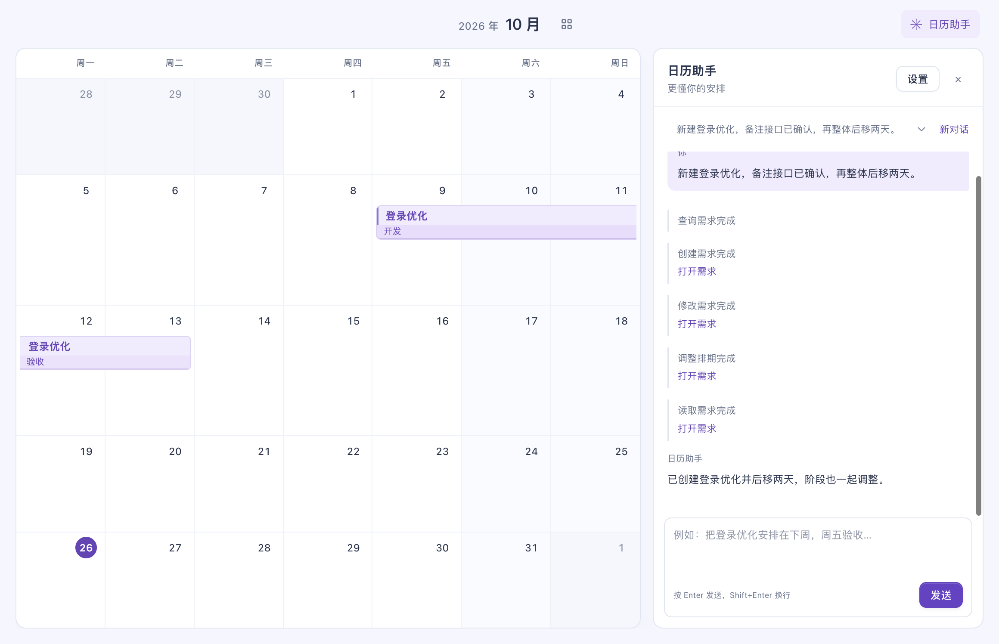

# 需求日历

一个能通过对话管理需求的桌面日历，面向需要安排开发、联调、测试和发布的个人与小团队。

把一个需求的时间、阶段、待办、资料链接和备注放在一起，在月历中查看进度；也可以告诉 AI 你想做什么，让它在你的授权范围内查询、创建、修改和删除需求。

- **看清排期**：上下滚动切换月份，跨月需求连续显示，支持阶段与关键节点。
- **和日历对话**：应用内的日历助手使用 DeepSeek Harness，结合当前日期、正在看的月份、对话历史和你填写的工作习惯提供帮助。
- **自己决定权限**：分别开启读取、创建、修改、删除；未保存草稿和版本冲突会阻止覆盖。
- **本机保存，可备份**：需求、偏好和会话历史本地保存，支持 JSON 备份，以及 CLI 和本机 API。



## 安装

前往 [下载页面](https://github.com/11eleve/requirement-calendar/releases/latest)，选择你的系统。AI 助手从 **0.6.0** 开始提供，旧版需要更新。

| 系统 | 下载文件 | 安装方式 |
| --- | --- | --- |
| Apple Silicon Mac，macOS 15+ | `macOS-arm64.dmg` | 打开后拖入 Applications |
| Apple Silicon Mac，macOS 15+ | `macOS-arm64.pkg` | 双击，按向导安装 |
| Windows x64 | `x64-Setup.exe` | 双击，按向导安装 |

安装包包含运行所需组件，普通用户无需安装 Node、Python 或编译源码。更新前退出旧版，已有需求会保留。Intel Mac 暂不支持。Mac 安装包尚未做 Developer ID 签名和公证，首次打开被系统拦截时，可确认来源后按 [Apple 的说明](https://support.apple.com/zh-cn/102445) 操作。

## 第一次使用

1. **添加需求**：点击日期，或拖出一段日期范围。填写名称、起止日期；按需添加阶段、待办、资料和备注，点击「保存需求」。
2. **查看安排**：上下滚动切换月份，点击年月跳转；点击需求查看详情，或切换到「需求汇总」搜索和筛选。
3. **备份数据**：在「文件」菜单中导出 JSON。导入时先查看预览，再选择合并、更新或恢复整份备份。

编辑表单需要主动保存。关闭或切换时，应用会提醒处理未保存内容。

## 使用日历助手

1. 点击右上角「日历助手」→「设置」。
2. 填入自己的 DeepSeek API Key，保留默认模型和服务地址，或填写兼容的 Messages 服务。模型调用使用你的服务账户，费用由该服务收取。
3. 填写「我的工作习惯」，例如「周五留给验收；大需求先拆阶段」。按需要开启读取、创建、修改和删除权限，保存后开始对话。

可以这样说：

> 看看本周有哪些需求，哪些排期可能冲突。
>
> 新建“登录优化”，安排在下周一到周五，分成开发、联调和验收三个阶段。
>
> 把“登录优化”整体推迟两天，阶段和节点一起移动。
>
> 删除刚才创建的测试需求。

助手会显示实际操作结果，成功写入后日历立即刷新。权限开关立即生效；默认只允许读取。可以随时停止对话、新建对话，或继续历史对话。

API Key 在 Mac 钥匙串或 Windows 系统加密存储中保存，不进入需求备份或聊天记录。对话时，消息、工作习惯和已授权读取的需求信息会发送到你配置的模型服务。AI 只能调用日历工具。

## 让其他 AI 或脚本操作日历

**本机 API**：在助手设置中开启「允许本机 API 调用」，查看地址和访问令牌。接口只监听 `127.0.0.1`，共用上述操作权限。

```sh
# URL 和 TOKEN 来自应用设置
curl "$URL/v1/status" -H "Authorization: Bearer $TOKEN"

# 使用刚才读取的 revision 创建需求
curl "$URL/v1/requirements" \
  -H "Authorization: Bearer $TOKEN" \
  -H 'Content-Type: application/json' \
  -H 'If-Match: 刚才返回的revision' \
  -d '{"id":"login-v2","title":"登录优化","start":"2026-11-02","end":"2026-11-06"}'
```

支持查询、详情、创建、修改、删除和整体平移。完整接口、权限与并发规则见 [AI 与 API 文档](docs/AI.md)。

**命令行**：Windows 安装后重开终端即可使用 `reqcal`；Mac 使用应用包内的二进制。

```powershell
reqcal schema
reqcal list
reqcal create --file requirement.json
reqcal export --output backup.json
```

```sh
"/Applications/需求日历.app/Contents/MacOS/reqcal" list
```

命令输出 JSON，适合 AI 和自动化脚本。更多参数见 [命令行文档](docs/CLI.md)。

## 数据保存在哪里

| 系统 | 数据目录 |
| --- | --- |
| Mac | `~/Library/Application Support/RequirementCalendar/` |
| Windows | `%APPDATA%\RequirementCalendar\data\` |

`calendar.json` 保存当前需求；`calendar.last-good.json` 保留上一份有效记录。助手的偏好、对话和运行记录放在 `assistant/` 子目录。更新或卸载应用不会主动删除这些数据。

需求写入采用原子保存和版本检查；恢复整份备份前会归档原数据。桌面版与浏览器预览的数据不自动同步。

## 从源码开发

需要 Node **24.9+**；前端离线构建需要 Python 3，Mac 原生构建还需要 Xcode Command Line Tools。

```sh
npm ci                   # 同时安装固定版本的 DeepSeek Harness
npm run desktop          # Electron 桌面开发，包含 AI
npm run dev              # 浏览器预览，仅日历界面
npm test                 # 日历规则与存储测试
npm run test:ai          # 真实 Harness + 本机模型协议测试，无需付费密钥
npm run test:desktop     # 桌面桥接测试，使用独立数据
npm run dist:win         # Windows 安装包，在 Windows 上执行
npm run dist:mac         # Mac 原生应用、DMG 和 PKG，在 Mac 上执行
```

```text
index.html        前端入口
src/              日历界面、领域规则、助手侧栏与存储桥接
desktop/ai/       DeepSeek Harness、日历工具、本机 API 和会话存储
desktop/macos/    Swift 原生窗口、文件保存、钥匙串、CLI 与 AI 桥接
desktop/electron/ Electron 宿主、系统加密存储和 AI 桥接
desktop/windows/ Windows 原生 CLI 与命名管道
scripts/          开发、构建和安装包工具
tests/            单元、AI、桌面和端到端测试
docs/             架构、API、命令行与发布说明
```

实现细节见 [项目架构](docs/ARCHITECTURE.md)。AI 使用官方 [DeepSeek Harness](https://github.com/deepseek-ai/deepseek-harness)，SDK 固定为 `0.2.1-rc.3`，升级需要重新验证工具边界与会话兼容性。
