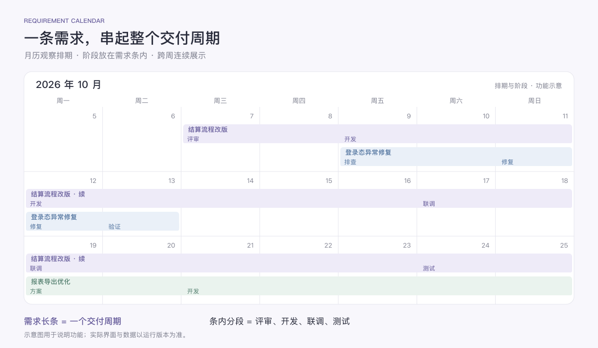
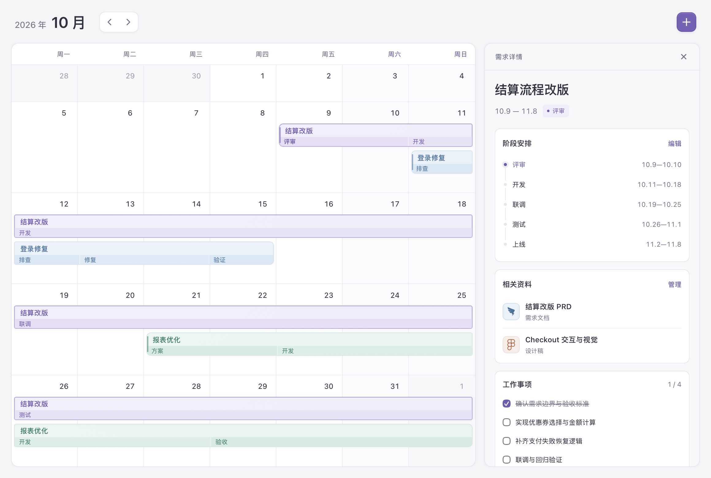
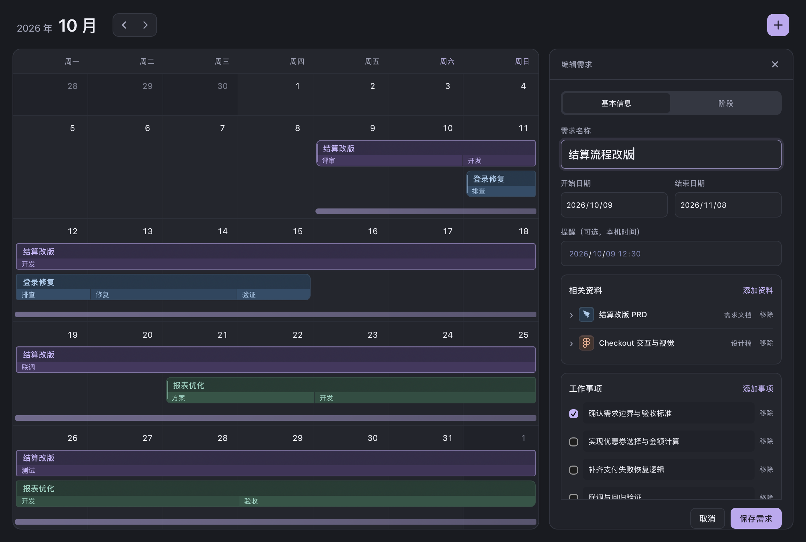

<p align="center">
  
</p>

<h1 align="center">需求日历</h1>

<p align="center">面向程序员的需求排期工具，把周期、阶段、资料和事项放在一起。</p>

一个需求可能持续几周，中间经历评审、开发、联调和测试；临时修复又可能只占一两天。需求日历以月历为主视图，用一条连续的长条表示完整需求，把各个阶段标在条内。点击需求，即可查看对应的文档、设计稿、工作事项和备忘。

**当前提供 macOS 桌面版源码，以及可离线打开的浏览器版。** 桌面版支持原生窗口与菜单、本机数据保存、JSON 备份恢复和可选系统提醒。目前需要从源码构建，尚未发布可直接下载的 DMG 或经过 Apple 公证的安装包。

<p align="center">
  <a href="#安装">安装</a> · <a href="#功能介绍">功能介绍</a> · <a href="#第一次使用">第一次使用</a> · <a href="#数据与备份">数据与备份</a> · <a href="#常见问题">常见问题</a>
</p>


*桌面版实际运行截图，展示示例排期。*

## 安装

### macOS 桌面版

#### 环境要求

| 项目 | 要求 |
| --- | --- |
| 系统 | macOS 15 或更新版本 |
| 编译工具 | Xcode Command Line Tools，包含 Swift 编译器 |
| 构建工具 | Python 3；使用 Git 克隆时还需要 Git |
| 仓库权限 | 当前为私有仓库，下载和克隆需要有读取权限的 GitHub 账号 |

Python 和编译工具仅在构建时使用。生成的应用启动时不需要 Node.js、Python 或本地服务器。

#### 1. 准备编译环境

如果尚未安装 Xcode Command Line Tools，在终端执行，按系统提示完成安装：

```bash
xcode-select --install
```

然后确认以下命令可用：

```bash
swiftc --version
python3 --version
```

如果提示找不到 `python3`，需要先安装 Python 3，再继续构建。

#### 2. 获取源码

完成本机 Git 对 GitHub 的认证后执行：

```bash
git clone https://github.com/11eleve/requirement-calendar.git
cd requirement-calendar
```

也可以登录 [GitHub 仓库](https://github.com/11eleve/requirement-calendar)，选择 **Code → Download ZIP**，解压后在终端进入包含 `README.md` 和 `scripts/` 的项目目录。

#### 3. 构建并启动

在项目目录中执行：

```bash
chmod +x scripts/build-macos.sh
scripts/build-macos.sh
open "dist/需求日历.app"
```

构建脚本会生成适合当前 Mac 架构的应用，包含多尺寸应用图标，并进行本机临时签名。构建成功后，应用位于 `dist/需求日历.app`。

#### 4. 放入应用程序文件夹

在 Finder 中打开项目的 `dist` 文件夹，将 **需求日历.app** 拖入“应用程序”。以后可以从启动台或 Spotlight 打开。

全新安装会打开空白月历，直接创建自己的需求；已有记录会自动载入。README 截图使用专门的示例数据。

更新时先退出应用，获取新源码，重新运行构建脚本，再替换旧应用。本机数据保存在应用包之外，替换 `.app` 不会主动删除已有需求；更新前仍建议导出备份。

> 当前使用本机临时签名，尚未提供 Developer ID 签名与 Apple 公证的分发包，也没有 Homebrew 安装或自动更新。

### 浏览器版：免构建体验

下载并解压仓库后，用 Safari、Chrome 或 Edge 打开**根目录的 `index.html`**，即可使用核心日历功能。macOS 也可以在项目目录执行：

```bash
open index.html
```

如果需要固定的本地访问地址，可选用 Python 启动静态文件服务：

```bash
python3 -m http.server 8080 --bind 127.0.0.1
```

打开 [http://127.0.0.1:8080](http://127.0.0.1:8080)，在终端按 `Ctrl+C` 停止服务。建议固定使用同一种打开方式、同一浏览器和同一个地址，避免切换到不同的浏览器存储位置。

| 能力 | macOS 桌面版 | 浏览器版 |
| --- | --- | --- |
| 月历排期、阶段、资料、事项与备忘 | 支持 | 支持 |
| 数据保存 | 独立本机 JSON 文件 | 浏览器 `localStorage` |
| 原生菜单与退出保存提示 | 支持 | 使用页面内编辑保护 |
| JSON 备份导出与恢复 | 原生文件菜单 | 暂无对应入口 |
| 按需求设置系统提醒 | 支持，需通知授权 | 不支持 |
| 云端同步 | 暂不支持 | 暂不支持 |

## 功能介绍

### 月历中的完整需求周期

月历是默认主视图。每个需求拥有开始与结束日期，既能安排单日修复，也能覆盖跨周、跨月的长期开发。同一时间推进的多个需求会分行显示，方便观察排期重叠与交付周期。

跨年需求会在详情、阶段日期和长条悬停信息中显示起止年份；当前年度内的短周期保持简洁日期。较长的阶段名称、技术事项和自定义资料类型可以完整换行，避免在窄详情面板中被裁掉。

历史需求不会挤占当前月份的行号。密集排期可以在日历区域内滚动，详情面板单独滚动；键盘移动日期焦点时，会将目标日期滚动到可见位置。

顶部保留月份、前后切换箭头和新建加号。只有创建或打开具体需求时才展开详情，把日常浏览空间留给日历。打开或编辑需求后，该需求的跨周长条会保持轻量选中提示，便于对应右侧内容；关闭详情后清除。

### 阶段直接显示在需求条内

评审、开发、联调、测试、上线等阶段属于同一个需求，直接分段显示在它的长条内部。阶段名称可以自定义，不需要把每个阶段再建成独立日历事项。

例如，“结算流程改版”可以持续数周，内部依次安排“评审 → 开发 → 联调 → 测试 → 上线”。在详情的 **阶段** 页设置各阶段日期；保存时会检查阶段是否超出需求周期，以及是否互相重叠。



*功能示意图，用于说明跨周需求与内部阶段的关系；实际界面见上方运行截图。*

### 一个需求，一处资料

在 **基本信息 → 相关资料** 中集中保存 PRD、设计稿、接口约定、代码仓库或问题记录。每份资料的名称、类型和链接都可以自行填写，按需添加、修改和移除。

| 示例名称 | 自定义类型 | 可填写的内容 |
| --- | --- | --- |
| 结算改版 PRD | 需求文档 | 钉钉文档等在线文档地址 |
| Checkout 交互与视觉 | 设计稿 | Figma 等设计稿地址 |
| 支付接口约定 | 接口 | 接口文档地址 |
| 上线前检查 | 检查清单 | 可只填写名称和类型，链接留空 |

链接支持 `http://` 和 `https://`。桌面版点击资料链接后，由系统默认浏览器打开。资料列表采用紧凑行布局，展开后编辑，较长内容在面板内部滚动。

资料会根据链接或类型显示本地矢量图标：钉钉与 Figma 使用对应标识，仓库、文档、设计和代码使用统一图形。修改链接或类型时，图标即时更新；图标随应用打包，离线也可显示。**当前尚未抓取真实网站 favicon 或浏览器标签页图标。**



*桌面版实际运行截图。查看详情时保留月历上下文；打开与关闭面板采用连贯过渡，并支持系统减少动态效果偏好。*

### 工作事项、进度与备忘

把需求拆成可勾选的工作事项，记录完成数量；用备忘保存评审结论、阻塞原因、接口约定和验收注意点。详情同时展示阶段安排与当前阶段，方便恢复上下文。

资料、事项和备忘都放在基本信息中。编辑面板只分为 **基本信息** 和 **阶段** 两页，超长内容在内部滚动。两页的切换控件在滚动时保持可见，切换后从对应内容顶部开始浏览。


*桌面版实际运行截图，展示编辑中的持续范围条与紧凑详情面板。*

<details>
<summary>查看深色外观</summary>



</details>

备忘保留缩进、换行与首尾空白，便于记录代码片段和接口约定；较长的签名文档链接也会完整保存。校验失败时，会展开并定位需要修正的具体字段。

### 直接在日历上创建排期

点击空白日期即可新建当天需求；拖过一段日期即可创建对应周期。支持反向拖动和跨周拖动，以最终松手的位置确定范围，系统会整理起止日期。拖到星期标题或日历外松手会取消；拖动时按 `Esc` 或窗口失焦也会取消，随后松手不会误建需求。也可以点击顶部加号后手动填写日期。

创建时使用彩色范围条反馈。松开鼠标后，范围条持续显示；修改日期时同步更新，取消编辑时清除，保存后由正式需求条接替。点击与拖动使用简短动画，并尊重系统“减少动态效果”偏好。

### 桌面操作与未保存保护

桌面版使用 AppKit 原生窗口和菜单，支持系统剪切、拷贝、粘贴、全选与文字撤销。

右键点击需求条可打开原生菜单，查看、编辑或删除需求。应用会记住窗口尺寸，显示菜单提供全屏入口。

| 快捷键 | 操作 |
| --- | --- |
| `⌘N` | 新建需求 |
| `⌘S` | 保存当前编辑 |
| `⌘W` | 关闭详情 |
| `⌘Z` | 在编辑器外撤销最近一次删除；文字编辑中保留系统文字撤销 |
| `⌃⌘F` | 切换桌面窗口全屏 |
| `⌘⌥←` / `⌘⌥→` | 切换月份 |
| `Esc` | 取消拖动或关闭详情 |
| 日期聚焦后按方向键 | 左右移动一天，上下移动一周 |
| 页签聚焦后按左右方向键 | 切换基本信息与阶段 |

切换需求或关闭编辑器时，如果有未保存内容，会询问保存、不保存或继续编辑。桌面版关闭窗口、退出应用时也提供原生保存提示。保存失败会保留表单并显示原因，便于修复后重试。

删除需求后可撤销最近一次删除；退出应用后不保留撤销记录。界面支持浅色与深色外观。

### 按需开启系统提醒

在桌面版 **基本信息 → 提醒** 中设置本机日期与时间。默认不提醒，首次打开应用也不会主动申请通知权限；首次保存带有未来提醒时间的需求时，才会请求 macOS 通知授权。

允许后，提醒由 macOS 本地通知系统安排。修改时间会替换原提醒，清空时间或删除需求会取消提醒，撤销删除会恢复尚未到期的提醒。点击通知会打开对应月份与需求；遇到未保存内容时先保护草稿。

需求会先保存到本机，通知授权或调度等待不会锁住编辑器；提醒状态会单独显示。拒绝授权也不会阻止需求保存。可稍后在 **系统设置 → 通知 → 需求日历** 中允许通知；专注模式与系统通知设置会影响横幅和声音。

> 提醒调度逻辑已通过隔离适配器测试，经用户允许后已开启验收副本通知，系统日志确认实际进入通知中心；横幅/声音受到共享屏幕设置抑制，真实点击定位仍待界面验证。浏览器版不提供此能力。

## 第一次使用

以“结算流程改版”为例：

1. 在月历中拖出整个交付周期，填写需求名称并确认起止日期。
2. 在基本信息中添加钉钉 PRD、Figma 设计稿与接口文档，自行命名资料类型。
3. 添加“确认验收标准”“实现核心逻辑”“完成回归”等工作事项。
4. 切换到阶段页，填写评审、开发、联调与测试的日期。
5. 如需提醒，在桌面版中设置提醒时间，然后保存。
6. 日常从月历点击需求，勾选完成事项，补充进展和阻塞信息。

## 数据与备份

### 数据保存在哪里

桌面版保存在本机独立目录：

```text
~/Library/Application Support/RequirementCalendar/
├── calendar.json            # 当前需求数据
└── calendar.last-good.json  # 最近一次有效备份，保存后产生
```

数据采用原子写入，并保留有效备份。发生损坏时会保留原始记录再进行恢复；多个应用进程之间也会检查过期写入，避免旧窗口直接覆盖新数据。首次启动新版桌面应用时，会迁移旧版 WebKit 记录并保留旧记录。

浏览器版使用该浏览器、该地址下的 `localStorage`。清理浏览器数据、隐私模式或切换访问地址可能影响记录。桌面版与浏览器版之间不会自动同步。

### 导出与恢复

桌面版的 **文件** 菜单提供：

- **导出备份…**：使用系统保存窗口，将全部已保存需求导出为 JSON。
- **从备份恢复…**：选择 JSON，校验并确认后替换当前记录。
- **显示数据文件夹**：在 Finder 中定位本机数据与自动备份。

导出或恢复前，先保存或取消当前编辑。恢复会替换全部需求，建议先导出当前版本；无效格式、重复标识、重叠阶段等内容会被校验拦截。

恢复前的有效记录会额外保存为 `calendar.before-restore-*.json`，后续正常保存不会替换这份归档。

自动备份与主文件位于同一目录，建议定期导出到其他位置。需求不会自动上传到 GitHub，也没有云端同步服务。

## 常见问题

### 能直接下载安装吗？

目前需要按上方步骤从源码构建 macOS 应用。仓库尚未提供 DMG、公证安装包、Homebrew 安装或自动更新。仅体验核心功能时，可以直接打开浏览器版。

### 为什么没有收到提醒？

确认使用桌面版、设置了未来的提醒时间并已保存，再检查 macOS 是否允许“需求日历”发送通知，以及专注模式是否限制展示。本机验收已确认实际进入通知中心；共享屏幕时可能静音且不显示横幅，点击通知仍待界面验证。

### 支持钉钉或 Figma 自动同步吗？

当前可以保存并打开相关链接，显示对应的内置矢量图标；尚未读取文档内容、抓取标签页图标或同步外部平台。

### 还有哪些能力尚未提供？

当前没有系统日历同步、菜单栏常驻、开机启动、团队协作与云端同步。需求数量没有固定的 16 条限制，实际容量受设备和存储空间影响。

## 开发

```text
requirement-calendar/
├── index.html       # 可直接打开的离线页面
├── src/             # 页面结构、样式、交互、数据模型与存储
├── native/          # AppKit 窗口、菜单、文件存储与系统提醒
├── scripts/         # 页面与 macOS 应用构建脚本
├── tests/           # 模型、构建、原生与 WebKit 回归
├── docs/            # 优化记录与验证证据
└── assets/          # 马赛克图标、实际截图与功能示意图
```

修改 `src/` 后重建离线页面，修改原生代码后重新构建应用：

```bash
python3 scripts/build.py
scripts/build-macos.sh
```

数据模型与构建测试需要 Node.js 和 Python 3：

```bash
node --test tests/model.test.cjs
python3 tests/build.test.py
```

详细改动与验证范围见 [优化记录](docs/OPTIMIZATION_LOG.md)。README 图标通过内置 imagegen 生成，生成提示词见 [图标说明](assets/icon-v2-prompt.md)。运行截图与功能示意图已分别标注。
