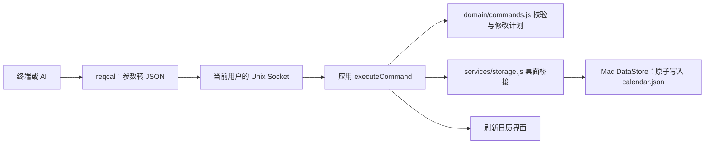

# 项目结构

需求日历是一个共享 Web 界面、按系统提供桌面宿主的应用。前端使用原生 HTML、CSS、JavaScript，没有 React/Vue 运行时；本次整理不引入框架迁移。

```text
index.html                  开发入口 HTML，引用 src 中的源码
src/
  main.js                   应用协调：启动、页面状态、编辑、日历交互
  domain/
    model.js                数据结构、校验、日期计算、迁移
    planning.js             只读汇总和排期投影
    commands.js             JSON 指令校验和修改计划
  services/
    storage.js              浏览器存储和桌面桥接适配
    site-icons.js           网站图标加载和回退
  components/
    elements.js             共用 DOM 控件
    icons.js                界面图标
    disclosure.js           展开与收起
    startup.js              启动动画
    assistant.js            日历助手侧栏、设置和会话操作
  styles/main.css           界面样式
desktop/
  ai/                       官方 DeepSeek Harness、专用工具、本机 API、会话存储
  macos/                    AppKit/WKWebView 宿主、文件存储、提醒、Socket、CLI
  electron/                 Electron 宿主、预加载桥接、Windows 提醒和安装配置
  windows/cli/              Windows 原生 reqcal、命名管道宿主和 PATH 安装脚本
assets/                     应用发布资源，目前是透明图标
bin/reqcal                  开发目录/便携包的 CLI 启动脚本
scripts/                    开发服务器、前端构建、桌面打包和验证
tests/
  ai/                       真实 Harness、API 权限与密钥恢复检查
  unit/                     JavaScript 单元检查和前端构建检查
  e2e/                      运行在真实 WebView 中的界面检查
  macos/                    Swift 检查和原生 CLI 集成检查
  windows/                  Windows 已安装 CLI、自动启动和重启恢复检查
docs/
  images/                   历史界面截图和图标设计记录
  verification/             历史验证报告
  releases/                 版本发布说明
dist/                       构建产物，Git 忽略
```

`main.js` 目前仍负责界面协调；目录整理不代表已把每个编辑器和视图拆成独立组件。共用业务模块保留浏览器全局与 CommonJS 双入口，方便 WebView 和 Electron 主进程复用同一份校验规则。

## 运行与构建

```sh
npm run dev                 # http://127.0.0.1:5173，浏览器开发；刷新查看源码更改
npm run build               # 生成离线单文件 dist/web/index.html，需要 Python 3
npm test                    # Node 单元检查
npm run test:build          # 前端构建检查
npm run desktop             # Electron 开发窗口，需要先 npm ci
npm run test:desktop        # Electron 集成检查，需要图形会话
npm run build:mac           # 构建 Mac .app 和原生 reqcal
npm run test:cli            # 对构建出的 Mac 应用进行隔离的 CLI 集成检查
npm run dist:mac            # 构建 Mac .app、PKG、DMG，并验证 DMG
npm run dist:win            # 构建 Windows NSIS 安装器
npm run build:cli:win       # 单独编译 Windows reqcal.exe，仅 Windows
```

浏览器开发只需要 Node，无需安装 Electron 依赖。`dev` 监听本机固定端口，只提供入口和前端资源；浏览器模式使用该地址下的 localStorage。它没有桌面的系统提醒和原生命令行服务器。

轻量构建器按入口声明的顺序内联 CSS 和 JavaScript，供 Mac WKWebView 离线加载；不会重写入口源码。Electron 通过受限的 `calendar-app://local` 协议加载相同的入口和嵌套资源，打包时一并包含它们。

## 为什么有 Swift

Mac 版本用 Swift 实现 AppKit 窗口和 WKWebView 容器，以及文件选择、菜单、原子文件保存、系统通知和本机 Socket。日历、编辑器、动画和 JSON 规则仍由共享前端实现，没有另一套 SwiftUI 日历。

`desktop/macos/CLI.swift` 也编译为独立可执行文件，用户使用 `reqcal` 不需要安装 Node/Python。Python 只用于开发构建。

Windows 版本由 Electron 提供对应宿主。Windows CLI 用 C# 编译为独立控制台程序，并提供当前用户专用的本机命名管道；业务规则继续共用 JavaScript。开发与测试启动脚本会在 Windows 自动编译 CLI，安装时无需 Node。

当前两个平台的宿主实现不同，因此需要分别维护桥接代码；改成 Mac 也用 Electron 属于后续架构选择，会涉及窗口、提醒、CLI 和安装包迁移。

## 命令行与数据



Windows 的对应链路为 `reqcal.exe → 命名管道 → 私有原生宿主 → Electron CommandBroker → executeCommand → DataStore`。命令行参数、JSON 指令和业务校验与 Mac 一致，通信通道按系统实现。

CLI 不直接编辑 `calendar.json`。应用操作入口负责草稿、忙碌和 revision 检查；纯业务层产生修改计划；原生存储负责原子落盘、备份和进程间冲突检查。普通界面编辑通过应用自身的编辑函数保存，并非每个按钮都调用命令规划器。

用户数据位于应用包之外，项目目录整理不会迁移或删除它。具体 CLI 用法见 [CLI.md](CLI.md)。


## 日历内的 AI

`desktop/ai` 是独立的 Node 服务包，固定使用官方 `@deepseek-ai/dsh-sdk-client` / `@deepseek-ai/dsh-tools` 0.2.1-rc.3。界面通过宿主的私有 stdio 桥接发送消息；API Key 由 Mac 钥匙串或 Electron safeStorage 加密保存，只在请求时交给运行时。

Mac 仍用 Swift 提供原生窗口和 WebView，安装包额外内嵌 Node 运行 AI 服务；Windows 使用 Electron 自带的 Node，两种系统都不要求用户另行安装运行时。`scripts/build-ai-runtime.cjs` 打包服务、固定依赖和许可证。

Harness 使用 sdk-minimal profile，禁用文件、终端与工作目录工具，并通过独立的工具准入限制仅开放 `calendar_*`。工具通过带私有令牌的本机接口进入服务，服务逐次检查权限和 revision，再通过宿主调用前端现有的 `executeCommand`。这条路径与 UI/CLI 共用数据校验、草稿保护、原子保存、备份和即时刷新。

对外 HTTP API 使用另一个令牌，默认关闭，仅监听 127.0.0.1；不接收浏览器跨站请求。开启后支持 REST 查询和增删改，写入需要 If-Match。权限适用于内置助手与 HTTP API；本机用户的 CLI 权限保持兼容。

工作习惯、对话和操作记录在 `assistant/` 下持久化，Harness 自身的运行历史在 `assistant/harness/`。应用重启后通过官方 resumeSession 恢复对话；停止会关闭运行时，已提交的需求变更保留。模型会收到消息、用户填写的工作习惯、当前日期/月份上下文和授权读取的需求，密钥不进入消息或需求 JSON。

验证同时覆盖真实 Harness 的模型协议、原生 Mac WebView 与 Electron 用户点击流程。付费模型端由本机 Messages 协议服务器替代，测试不使用或收集用户 API Key。
